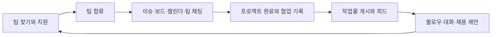
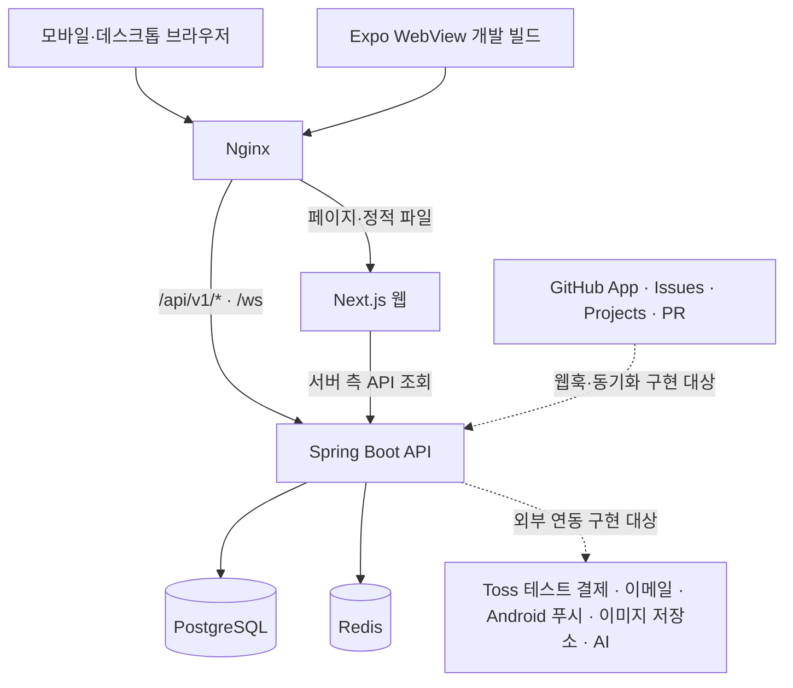

# Linker

**개발자의 팀 찾기부터 GitHub 협업, 프로젝트 공유와 채용 제안까지 연결하는 서비스입니다.**

작업 기록이 다음 프로젝트의 포트폴리오가 되도록, 모집·이슈·일정·채팅·작업물 피드를 하나의 흐름으로 묶습니다.



## 서비스 개요

| 영역         | 주요 기능                                                         | 주요 경로                                                         |
| ------------ | ----------------------------------------------------------------- | ----------------------------------------------------------------- |
| 팀 찾기      | 모집글 작성·검색 조건·지원·지원자 검토·수락/거절                  | `/recruits`                                                       |
| 워크스페이스 | GitHub 조직과 팀 연결, 레포·멤버·초대·프로젝트 완료 관리          | `/workspace`, `/teams/[id]/settings`                              |
| 협업         | GitHub 이슈 작성·담당자·라벨·상태·일정, 보드와 캘린더             | `/teams/[id]/issues`, `/teams/[id]/board`, `/teams/[id]/calendar` |
| 채팅·알림    | 팀/개인 대화, 메시지 요청, PR 안내, 인앱 알림                     | `/chats`, `/notifications`                                        |
| 프로필·소셜  | 기술 스택, GitHub 기여, 완료 기록, 작업물·피드·좋아요·댓글·팔로우 | `/u/[login]`, `/posts/[id]`, `/feed`                              |
| 리크루팅     | 기업 이메일 가입, 구직 상태 확인, 채용 제안과 보낸 제안 목록      | `/recruiter/signup`, `/recruiter/offers`                          |
| 구독·운영    | Pro/Flex/Scout 구독, 통계, 신고·회원·운영 조치 기록               | `/subscribe`, `/me/stats`, `/admin/*`                             |

### 사용자 유형

- **비회원:** 피드·게시글·모집글·프로필을 읽을 수 있습니다. 쓰기·반응·지원·대화에는 로그인이 필요합니다.
- **개발자:** GitHub로 가입하고 팀 활동·소셜 기능을 이용합니다.
- **채용 담당자:** 기업 이메일로 가입하고 개발자에게 채용 제안을 보냅니다.
- **운영자:** 개발자 계정에 운영 권한과 OTP 인증을 더해 신고와 이용 상태를 관리합니다.

역할별 접근 권한, 팀 오너/관리자/멤버 권한, 수치와 예외는 [서비스 정책](docs/planning/04-policy.md)을 기준으로 합니다.

### MVP 범위와 현재 구현 단계

5명이 2주 동안 개발하는 포트폴리오 MVP입니다. 모바일 우선 반응형 웹과 같은 화면을 사용하는 Expo WebView 개발 빌드를 대상으로 하며, 앱스토어 출시는 범위에 포함하지 않습니다. 결제는 Toss Payments **테스트 모드**를 사용합니다.

2026-11-02 저장소 확인 기준:

- 프론트엔드에는 A~E 담당 화면의 기본 구현과 목업 모드가 병합돼 있습니다. 화면이 있다는 것과 실제 API·외부 서비스까지 동작한다는 것은 구분합니다.
- 백엔드는 Spring Boot 애플리케이션, JPA·PostgreSQL·Redis 연결 설정 등 기반이 있으며, 업무 컨트롤러와 실제 인증·채팅·결제 연동은 후속 구현 대상입니다.
- Docker Compose·Nginx 실행 구성과 CI가 있으며, 운영 문서에 `main` 기반 첫 자동 배포 성공과 외부 HTTPS 확인이 기록돼 있습니다. `dev → main` 병합이 실제 배포를 시작하며, 후속 변경도 [자동 배포 가이드](docs/operations/04-automatic-deployment.md)에 따라 확인합니다.
- AI 요약·진행 현황 등 `[Included]` 항목은 핵심 `[Required]` 기능 이후에 진행합니다. 외부 제공자·AI 모델 등 미확정 항목은 구현 전에 팀에서 결정합니다.

전체 기획 범위는 [MVP 정의](docs/planning/03-mvp-definition.md), 페이지별 완료 조건은 [페이지 TODO](docs/planning/07-page-todo.md)를 참고하세요. WBS의 **33개 페이지·18개 시스템 컨트롤러·205개 REST 엔드포인트·69개 테이블**은 설계 규모이며 현재 구현 완료 수가 아닙니다.

## 팀 구성과 담당 범위

**한 사람이 담당 페이지의 프론트엔드와 백엔드를 함께 맡습니다.** 페이지·컨트롤러·API의 소유자는 [WBS](docs/development/02-wbs.md)를 기준으로 합니다. 아래 계정은 담당 영역의 병합 PR과 대조했습니다.

| 구분 | 팀원                                      | 담당 영역                          | 담당 페이지·협업 영역                                              |
| ---- | ----------------------------------------- | ---------------------------------- | ------------------------------------------------------------------ |
| A    | [OMS-cc](https://github.com/OMS-cc)       | 계정·프로필·신고 처리·리크루팅     | 01~06, 25, 31~33 · 인증/온보딩, 프로필, 운영 OTP, 채용 담당자 계정 |
| B    | [D-Gyun103](https://github.com/D-Gyun103) | GitHub 연동·팀·운영 회원/기록·통계 | 07~10, 26, 27, 30 · 17의 PR 안내/목록, WebView 브리지·배포 기반    |
| C    | [jangabc3](https://github.com/jangabc3)   | 이슈·상태 보드·캘린더              | 11~15 · 07의 내 이슈, 17의 Flex AI 요약, 11의 Flex 진행 현황       |
| D    | [Yunsu0407](https://github.com/Yunsu0407) | 채팅·알림·구독                     | 16~18, 28, 29 · STOMP, 메시지 요청/채용 제안, 결제·혜택·해지/환불  |
| E    | [JUNHORANG](https://github.com/JUNHORANG) | 팀 찾기·모집·작업물·피드           | 19~24 · 지원/수락, 게시글·소셜, 공통 시트·이미지 업로드            |

00 공통 기반은 전원이 나눠 맡습니다. A는 인증·접근 제어, B는 GitHub App·네이티브 브리지·인프라, C는 정책 상수·SEO·테스트, D는 STOMP·알림·제한 정책, E는 모노레포·API 호출·공통 UI를 담당합니다.

### 협업 방식

1. **D1~D2:** 공통 기반과 GitHub 로그인/설치·Projects·웹훅·STOMP·테스트 결제의 위험 구간을 먼저 검증합니다.
2. **D3~D5:** 로그인 → 온보딩 → 팀 생성 → 이슈 → 팀 채팅을 연결합니다.
3. **D6~D9:** 모집/지원/합류 → 프로젝트 완료 → 작업물 → 피드/대화 → 구독/운영으로 확장합니다.
4. **D10:** `[Required]` 완료 조건, 모바일/WebView, 권한·예외·재시도와 팀 간 연결을 통합 검증합니다.

다른 페이지의 API는 원래 담당자의 것을 재사용합니다. 팀 합류는 B·D·E, PR 안내는 B·D, 이슈/AI 요약은 B·C·D, 프로필/대표 작업물/통계는 A·B·E, 구독 혜택은 D와 각 화면 담당자가 함께 확인합니다.

작업은 최신 `dev`에서 `feat/`, `fix/`, `chore/`, `docs/` 브랜치를 만들어 진행합니다. 커밋은 `<type>: <description>`, PR은 작업 브랜치 → `dev`로 올리고 리뷰·검증 후 병합합니다. `main`·`dev`에 직접 커밋하지 않습니다.

### GitHub 작업 이슈

프론트엔드는 기존 목업 화면의 보완·실제 API 연동·최종 검증을, 백엔드는 공통 기반과 WBS API/도메인 구현을 추적합니다. 기능을 전부 다시 만드는 목록이 아니며, 체크 여부는 실제 완료 근거와 함께 갱신합니다.

<!-- TEAM_ISSUES_START -->

| 담당 | 프론트엔드                                                            | 백엔드                                                                |
| ---- | --------------------------------------------------------------------- | --------------------------------------------------------------------- |
| 공통 | [#48](https://github.com/likelion-backendschool-9th/Linker/issues/48) | [#49](https://github.com/likelion-backendschool-9th/Linker/issues/49) |
| A    | [#50](https://github.com/likelion-backendschool-9th/Linker/issues/50) | [#51](https://github.com/likelion-backendschool-9th/Linker/issues/51) |
| B    | [#52](https://github.com/likelion-backendschool-9th/Linker/issues/52) | [#53](https://github.com/likelion-backendschool-9th/Linker/issues/53) |
| C    | [#54](https://github.com/likelion-backendschool-9th/Linker/issues/54) | [#55](https://github.com/likelion-backendschool-9th/Linker/issues/55) |
| D    | [#56](https://github.com/likelion-backendschool-9th/Linker/issues/56) | [#57](https://github.com/likelion-backendschool-9th/Linker/issues/57) |
| E    | [#58](https://github.com/likelion-backendschool-9th/Linker/issues/58) | [#59](https://github.com/likelion-backendschool-9th/Linker/issues/59) |

<!-- TEAM_ISSUES_END -->

> 아래 이슈 본문의 `WBS 컨트롤러:`와 `LoginController`·`IssueListController` 같은 컨트롤러명은 #156 이전의 페이지별 컨트롤러 표기입니다. API 소속 시스템 컨트롤러와 경로·권한은 [WBS](docs/development/02-wbs.md) §4·§5를 따릅니다.

<!-- PAGE_ISSUE_INDEX_START -->

담당자별 이슈는 상위 추적으로 유지하고, 실행할 작업은 **페이지별 프론트엔드 36개·백엔드 36개**로 나눴습니다. 33개 페이지 중 07의 내 이슈(C), 17의 PR(B)·AI 요약(C)을 분리한 36개 작업 범위이며 새 페이지를 추가한 것이 아닙니다. 00 공통 기반은 기존 #48·#49에서 담당자별로 관리합니다.

각 세부 이슈에는 화면/도메인 체크리스트, 권한·입력 제한·예외, WBS API와 관련 테이블, 협업/상대 FE·BE 링크, 완료 검증과 근거 문서가 있습니다. `[Included]`는 핵심 `[Required]` 이후 진행합니다.

<details>
<summary>페이지별 세부 이슈 72개 보기</summary>

| 페이지 | 담당 | 작업                                                | 프론트엔드                                                              | 백엔드                                                                  |
| ------ | ---- | --------------------------------------------------- | ----------------------------------------------------------------------- | ----------------------------------------------------------------------- |
| 01     | A    | 시작 화면·GitHub 로그인                             | [#62](https://github.com/likelion-backendschool-9th/Linker/issues/62)   | [#63](https://github.com/likelion-backendschool-9th/Linker/issues/63)   |
| 02     | A    | 온보딩·동의·기본 프로필                             | [#64](https://github.com/likelion-backendschool-9th/Linker/issues/64)   | [#65](https://github.com/likelion-backendschool-9th/Linker/issues/65)   |
| 03     | A    | 약관·개인정보·정책 문서 뷰어                        | [#66](https://github.com/likelion-backendschool-9th/Linker/issues/66)   | [#67](https://github.com/likelion-backendschool-9th/Linker/issues/67)   |
| 04     | A    | 프로필·팔로우·작업물·채용 담당자 마이페이지         | [#68](https://github.com/likelion-backendschool-9th/Linker/issues/68)   | [#69](https://github.com/likelion-backendschool-9th/Linker/issues/69)   |
| 05     | A    | 프로필 수정·GitHub 다시 불러오기                    | [#70](https://github.com/likelion-backendschool-9th/Linker/issues/70)   | [#72](https://github.com/likelion-backendschool-9th/Linker/issues/72)   |
| 06     | A    | 설정·알림 설정·차단·탈퇴                            | [#73](https://github.com/likelion-backendschool-9th/Linker/issues/73)   | [#74](https://github.com/likelion-backendschool-9th/Linker/issues/74)   |
| 07     | B    | 워크스페이스·팀 목록·팀 전환                        | [#75](https://github.com/likelion-backendschool-9th/Linker/issues/75)   | [#76](https://github.com/likelion-backendschool-9th/Linker/issues/76)   |
| 07-my  | C    | 내 이슈 목록 `[Included]`                           | [#77](https://github.com/likelion-backendschool-9th/Linker/issues/77)   | [#78](https://github.com/likelion-backendschool-9th/Linker/issues/78)   |
| 08     | B    | GitHub App 설치·팀 생성 5단계                       | [#79](https://github.com/likelion-backendschool-9th/Linker/issues/79)   | [#80](https://github.com/likelion-backendschool-9th/Linker/issues/80)   |
| 09     | B    | 팀 설정·멤버·소유권·완료 관리                       | [#81](https://github.com/likelion-backendschool-9th/Linker/issues/81)   | [#82](https://github.com/likelion-backendschool-9th/Linker/issues/82)   |
| 10     | B    | 초대 링크 확인·팀 참여                              | [#83](https://github.com/likelion-backendschool-9th/Linker/issues/83)   | [#84](https://github.com/likelion-backendschool-9th/Linker/issues/84)   |
| 11     | C    | 이슈 목록·필터·일정 없음·진행 현황                  | [#85](https://github.com/likelion-backendschool-9th/Linker/issues/85)   | [#86](https://github.com/likelion-backendschool-9th/Linker/issues/86)   |
| 12     | C    | 이슈 상세·담당자/라벨/일정/상태 시트                | [#87](https://github.com/likelion-backendschool-9th/Linker/issues/87)   | [#88](https://github.com/likelion-backendschool-9th/Linker/issues/88)   |
| 13     | C    | 이슈 작성·템플릿·생성 진행/복구                     | [#89](https://github.com/likelion-backendschool-9th/Linker/issues/89)   | [#90](https://github.com/likelion-backendschool-9th/Linker/issues/90)   |
| 14     | C    | 상태 보드·드래그·키보드 상태 변경                   | [#91](https://github.com/likelion-backendschool-9th/Linker/issues/91)   | [#92](https://github.com/likelion-backendschool-9th/Linker/issues/92)   |
| 15     | C    | 캘린더·기간 막대·날짜별 이슈                        | [#93](https://github.com/likelion-backendschool-9th/Linker/issues/93)   | [#94](https://github.com/likelion-backendschool-9th/Linker/issues/94)   |
| 16     | D    | 채팅 목록·메시지 요청                               | [#95](https://github.com/likelion-backendschool-9th/Linker/issues/95)   | [#96](https://github.com/likelion-backendschool-9th/Linker/issues/96)   |
| 17     | D    | 팀·개인 채팅·사진·메시지 메뉴·공유                  | [#97](https://github.com/likelion-backendschool-9th/Linker/issues/97)   | [#98](https://github.com/likelion-backendschool-9th/Linker/issues/98)   |
| 17-pr  | B    | 채팅 PR 목록·시스템 메시지                          | [#99](https://github.com/likelion-backendschool-9th/Linker/issues/99)   | [#100](https://github.com/likelion-backendschool-9th/Linker/issues/100) |
| 17-ai  | C    | Flex AI 채팅 요약·할 일→이슈 `[Included]`           | [#101](https://github.com/likelion-backendschool-9th/Linker/issues/101) | [#102](https://github.com/likelion-backendschool-9th/Linker/issues/102) |
| 18     | D    | 알림 목록·읽음·이의 제기·Android 푸시               | [#103](https://github.com/likelion-backendschool-9th/Linker/issues/103) | [#104](https://github.com/likelion-backendschool-9th/Linker/issues/104) |
| 19     | E    | 모집글 목록·필터·내 모집/지원                       | [#105](https://github.com/likelion-backendschool-9th/Linker/issues/105) | [#106](https://github.com/likelion-backendschool-9th/Linker/issues/106) |
| 20     | E    | 모집글 작성·수정·마감/재개                          | [#107](https://github.com/likelion-backendschool-9th/Linker/issues/107) | [#108](https://github.com/likelion-backendschool-9th/Linker/issues/108) |
| 21     | E    | 모집 상세·지원·지원자 검토/수락                     | [#109](https://github.com/likelion-backendschool-9th/Linker/issues/109) | [#110](https://github.com/likelion-backendschool-9th/Linker/issues/110) |
| 22     | E    | 작업물 작성·레포/사진·초안                          | [#111](https://github.com/likelion-backendschool-9th/Linker/issues/111) | [#112](https://github.com/likelion-backendschool-9th/Linker/issues/112) |
| 23     | E    | 작업물 상세·좋아요/댓글·유입 기록                   | [#113](https://github.com/likelion-backendschool-9th/Linker/issues/113) | [#114](https://github.com/likelion-backendschool-9th/Linker/issues/114) |
| 24     | E    | 홈 피드·추천·광고 카드                              | [#115](https://github.com/likelion-backendschool-9th/Linker/issues/115) | [#116](https://github.com/likelion-backendschool-9th/Linker/issues/116) |
| 25     | A    | 운영 신고·조치·이의 제기                            | [#117](https://github.com/likelion-backendschool-9th/Linker/issues/117) | [#118](https://github.com/likelion-backendschool-9th/Linker/issues/118) |
| 26     | B    | 운영 회원·제재·이메일 열람·환불                     | [#119](https://github.com/likelion-backendschool-9th/Linker/issues/119) | [#120](https://github.com/likelion-backendschool-9th/Linker/issues/120) |
| 27     | B    | 운영 조치 기록·기간/운영자 필터                     | [#121](https://github.com/likelion-backendschool-9th/Linker/issues/121) | [#122](https://github.com/likelion-backendschool-9th/Linker/issues/122) |
| 28     | D    | 요금제·Toss 테스트 결제·승인 결과                   | [#123](https://github.com/likelion-backendschool-9th/Linker/issues/123) | [#124](https://github.com/likelion-backendschool-9th/Linker/issues/124) |
| 29     | D    | 구독 관리·해지·환불·만료/유예                       | [#125](https://github.com/likelion-backendschool-9th/Linker/issues/125) | [#126](https://github.com/likelion-backendschool-9th/Linker/issues/126) |
| 30     | B    | 내 통계·Pro 유입/채용 조회·대표 작업물 `[Included]` | [#127](https://github.com/likelion-backendschool-9th/Linker/issues/127) | [#128](https://github.com/likelion-backendschool-9th/Linker/issues/128) |
| 31     | A    | 채용 담당자 가입·회사 이메일 인증 `[Included]`      | [#129](https://github.com/likelion-backendschool-9th/Linker/issues/129) | [#130](https://github.com/likelion-backendschool-9th/Linker/issues/130) |
| 32     | A    | 채용 담당자 로그인·비밀번호 재설정 `[Included]`     | [#131](https://github.com/likelion-backendschool-9th/Linker/issues/131) | [#132](https://github.com/likelion-backendschool-9th/Linker/issues/132) |
| 33     | A    | 보낸 채용 제안 목록·요약·첫 메시지 `[Included]`     | [#133](https://github.com/likelion-backendschool-9th/Linker/issues/133) | [#134](https://github.com/likelion-backendschool-9th/Linker/issues/134) |

</details>

<!-- PAGE_ISSUE_INDEX_END -->

## 서비스 구조

### 실행 구성과 데이터 흐름



- **웹과 앱:** 화면은 Next.js에서 구현합니다. Expo는 WebView로 같은 웹을 열고 로그인 복귀·공유·Android 뒤로가기·푸시를 네이티브 브리지로 연결합니다.
- **로컬 통합 실행:** Nginx가 웹, `/api/v1/*` REST, `/ws` 연결을 분기합니다. Next.js 서버 측 요청은 컨테이너 내부 Spring 주소를 사용합니다.
- **목업 실행:** `apiFetch`가 Spring 대신 `src/mocks/`에서 응답을 받습니다. 일반 빌드에는 목업을 포함하지 않습니다.
- **데이터 소유권:** GitHub가 조직·레포·이슈·PR·Projects의 원본입니다. Linker는 웹훅과 주기적 동기화로 DB 사본을 유지하는 구조로 구현합니다. 채팅·지원·게시글·구독·운영 기록은 Linker가 관리합니다.
- **인증 경계:** Spring이 실제 권한을 검증하며 JWT는 httpOnly 쿠키에 둡니다. 브라우저 JavaScript나 네이티브 브리지로 JWT를 전달하지 않습니다.
- **설계 제안:** 백엔드 청사진의 Next.js BFF는 제안 단계입니다. 현재 브라우저 REST는 Nginx를 통해 Spring으로 전달되며 BFF가 구현된 것으로 간주하지 않습니다.

### 기술 구성

| 구분           | 구성                                                                      |
| -------------- | ------------------------------------------------------------------------- |
| 웹             | Next.js 16, React 19, TypeScript, CSS Modules·디자인 토큰, Radix UI       |
| 상태·API       | TanStack Query, Zustand, nuqs · OpenAPI → orval 생성 계약                 |
| 앱             | Expo, React Native WebView, 공용 브리지 타입                              |
| 서버 기반      | Java 21, Spring Boot 4.1.2, Gradle, Spring Data JPA·Redis                 |
| 서버 후속 구현 | Spring Security, WebSocket·STOMP, springdoc, 외부 연동·동기화 작업        |
| 데이터·실행    | PostgreSQL 16, Redis 7, Nginx, Docker Compose                             |
| 검증·배포      | Vitest, Testing Library, Playwright·axe, GitHub Actions, GHCR 이미지 배포 |

### 저장소 구조

```text
Linker/
├── frontend/
│   ├── apps/web/          # Next.js 화면·공통 UI·목업·테스트
│   ├── apps/mobile/       # Expo WebView 개발 빌드
│   └── packages/          # api, bridge, config 공용 패키지
├── backend/               # Spring Boot / com.linker.backend
├── docs/
│   ├── planning/          # 서비스 기획·PRD·MVP·정책·페이지 TODO
│   ├── development/       # ERD·WBS·프론트/백엔드 청사진·디자인
│   └── operations/        # 로컬 설정·Docker·서버·자동 배포
├── nginx/                 # 로컬·운영 프록시와 호스트 설정 예시
├── deploy/                # 이미지 배포·적용 스크립트와 테스트
├── scripts/               # 저장소·배포 구성 검증 도구
├── compose*.yml           # 기본·개발·운영·이미지 실행 구성
└── .github/               # CI·배포·PR/이슈 템플릿
```

## 로컬 실행

### 프론트엔드 화면만 확인

Node.js 22 이상과 pnpm 10.15.0이 필요합니다. CI는 Node.js 24를 사용합니다.

```bash
# pnpm이 없는 경우 최초 1회
npm install -g pnpm@10.15.0

cd frontend
pnpm install --frozen-lockfile
pnpm dev:mock
```

브라우저에서 **http://localhost:3000**에 접속합니다. 화면 왼쪽 아래 **목업 계정**에서 비회원·개발자·신규 가입자·채용 담당자·운영자로 전환할 수 있습니다. 종료는 `Ctrl+C`입니다.

목업 로그인은 실제 GitHub 인증이 아닙니다. 일반 목업 데이터는 서버와 브라우저가 별도 메모리에 보관하므로 브라우저에서 만든 항목을 서버가 조회하지 못할 수 있습니다. 결제·구독 목업 일부는 브라우저 세션 저장소를 사용합니다.

### 웹·서버·DB·Redis 통합 실행

Docker와 Compose를 준비하고, 최초 실행 시 루트 `.env.example`을 바탕으로 `.env`의 `DB_PASSWORD`를 설정합니다. 기존 `.env`는 유지합니다.

```bash
# 저장소 루트에서 실행
docker compose up -d --build --wait --wait-timeout 240
docker compose ps
```

기본 접속 주소는 **http://localhost:8000**입니다. 일반 Docker 빌드는 목업을 사용하지 않으므로 업무 기능에는 실제 백엔드 구현이 필요합니다. 소스 자동 반영과 Compose 버전 조건은 [Docker 실행 가이드](docs/operations/02-docker.md)를, DB 도구 접속은 [로컬 DB 안내](docs/operations/05-database-access.md)를 참고하세요.

Expo 실기기 실행은 `frontend/apps/mobile/.env.example`의 웹 주소를 개발 PC의 LAN IP로 설정하고 개발 빌드를 사용합니다. 상세 절차는 [프론트엔드 청사진](docs/development/03-frontend-blueprint.md)의 앱·브리지 항목을 따릅니다.

### 검증 명령

```bash
cd frontend
pnpm lint
pnpm typecheck
pnpm test
pnpm build
```

백엔드는 PostgreSQL·Redis와 DB 환경변수를 준비한 뒤 `backend`에서 `./gradlew build`로 검증합니다. 서버 배포와 자동 배포는 로컬 실행과 구분해 운영 문서를 따릅니다.

## 문서 안내

| 문서                                                                                                              | 확인할 내용                                       |
| ----------------------------------------------------------------------------------------------------------------- | ------------------------------------------------- |
| [서비스 기획](docs/planning/01-service-plan.md) · [PRD](docs/planning/02-prd.md)                                  | 서비스 방향·사용자 흐름·기능 완료 조건            |
| [MVP 정의](docs/planning/03-mvp-definition.md) · [정책](docs/planning/04-policy.md)                               | 포함/제외 범위·역할·수치·상태·예외·UI 문구        |
| [페이지 TODO](docs/planning/07-page-todo.md)                                                                      | 01~33 페이지와 URL·화면 항목                      |
| [ERD](docs/development/01-erd.md) · [WBS](docs/development/02-wbs.md)                                             | 테이블·컬럼·컨트롤러·API·담당·의존성              |
| [프론트 청사진](docs/development/03-frontend-blueprint.md) · [디자인 가이드](docs/development/04-design-guide.md) | 프론트 구현 규칙·토큰·컴포넌트 스타일             |
| [백엔드 청사진](docs/development/05-backend-blueprint.md)                                                         | 서버 도메인·보안·트랜잭션·연동 설계와 미확정 제안 |
| [저장소 설정](docs/operations/01-setup.md) · [Docker](docs/operations/02-docker.md)                               | 개발 환경·CI·로컬 컨테이너 실행                   |
| [서버 운영](docs/operations/03-deployment.md) · [자동 배포](docs/operations/04-automatic-deployment.md)           | 운영 구성·HTTPS·main 배포 초기 설정과 절차        |
| [로컬 DB](docs/operations/05-database-access.md) | Docker Compose 로컬 DB, `127.0.0.1:5500`, 볼륨·비밀번호 |

README는 프로젝트의 입구입니다. 상세 수치·권한은 정책, 화면은 페이지 TODO, API·담당은 WBS, 데이터 구조는 ERD를 우선합니다.
