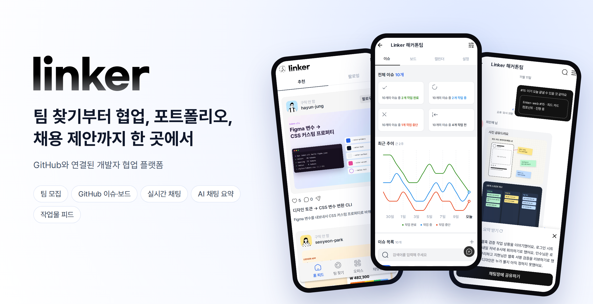

<div align="center">

### 일하는 방식이 곧 포트폴리오가 되는 개발자 협업 플랫폼

팀 모집 → GitHub 협업 → 작업물 공유 → 채용 제안을 **하나의 흐름**으로 연결합니다.

[**🔗 서비스 바로가기**](https://linker.newlecture.com) &nbsp;·&nbsp;
[**📘 기획 문서**](docs/planning/01-service-plan.md) &nbsp;·&nbsp;
[**🧩 WBS·API**](docs/development/02-wbs.md) &nbsp;·&nbsp;
[**🗂 ERD**](docs/development/01-erd.md)

<br />


</div>

<br />

<details open>
<summary><b>목차</b></summary>

1. [Linker를 만든 이유](#-linker를-만든-이유)
2. [주요 기능](#-주요-기능)
3. [사용자 흐름과 역할](#-사용자-흐름과-역할)
4. [구현 현황](#-구현-현황)
5. [기술 스택](#-기술-스택)
6. [아키텍처](#-아키텍처)
7. [핵심 설계 포인트](#-핵심-설계-포인트)
8. [팀 소개](#-팀-소개)
9. [시작하기](#-시작하기)
10. [배포](#-배포)
11. [저장소 구조와 문서](#-저장소-구조와-문서)

</details>

<br />

## 💡 Linker를 만든 이유

사이드 프로젝트·부트캠프·동아리·해커톤 팀에서 일하는 주니어·구직 개발자가 겪는 세 가지 불편에서 출발했습니다.

| 불편 | 지금은 이렇게 해요 | Linker에서는 |
| --- | --- | --- |
| **작업 공간이 흩어져 있다** | 이슈는 GitHub, 대화는 Discord, 일정은 Notion, 회의록은 카카오톡에 따로 둡니다. "이번 주에 누가 뭘 하지?"를 보려면 앱 네 개를 열어야 해요. | GitHub를 원본으로 두고, 그 위에 **이슈·보드·캘린더·팀 채팅**을 모바일 한 화면에 모았습니다. PR 소식은 팀 채팅에 자동으로 올라옵니다. |
| **팀원을 찾기 어렵다** | 모집글이 커뮤니티마다 흩어져 있고, 지원자의 실력과 끝까지 함께할지는 자기소개 몇 줄로만 판단합니다. | 모집·지원·수락부터 **GitHub 팀 합류**까지 한 번에 이어집니다. 지원자의 기술 스택·기여·완료 기록을 함께 보여 줍니다. |
| **작업물을 보여 줄 곳이 없다** | 끝난 프로젝트는 레포에만 남고, 피드백을 받거나 개발자끼리 연결될 공간이 없습니다. | 완료한 프로젝트를 **작업물 피드**에 올리고 좋아요·댓글·팔로우로 연결합니다. 이 기록을 보고 채용 담당자가 **채용 제안**을 보냅니다. |

> 핵심은 **새 도구를 하나 더 만드는 것이 아니라**, GitHub를 원본으로 유지하면서 그 위에 모바일 화면과 대화를 얹는 것입니다. 자세한 내용은 [서비스 기획](docs/planning/01-service-plan.md) 2장에 있습니다.

<br />

## ✨ 주요 기능

> 모바일 우선 웹이며 Expo WebView 앱도 같은 화면을 씁니다. 아래 화면은 목업 모드(`pnpm dev:mock`)의 더미 데이터로 390px 너비에서 캡처했습니다.

### 🔎 팀 찾기 — 모집부터 합류까지

모집글을 진행 방식·목적별로 찾고 지원합니다. 모집자는 지원자를 검토해 수락하고, 수락된 지원자는 바로 팀과 GitHub 조직에 합류합니다.

<table>
  <tr>
    <td align="center" width="33%">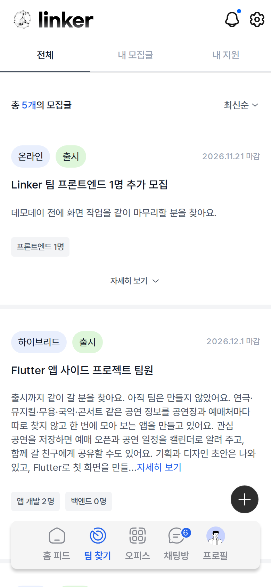</td>
    <td align="center" width="33%">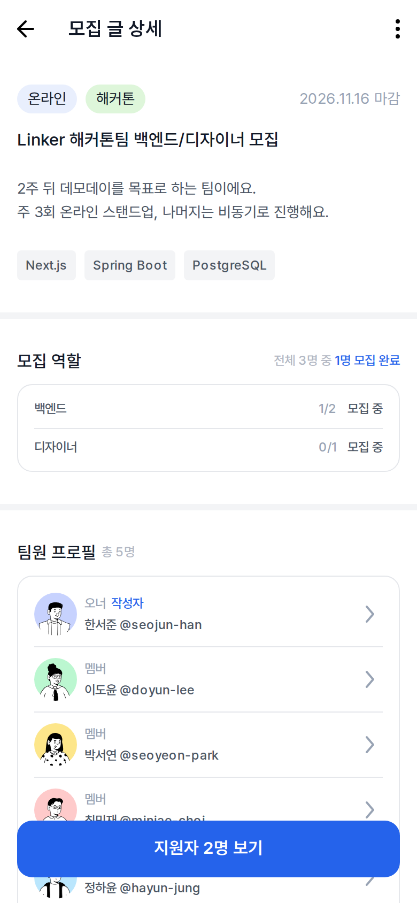</td>
    <td align="center" width="33%">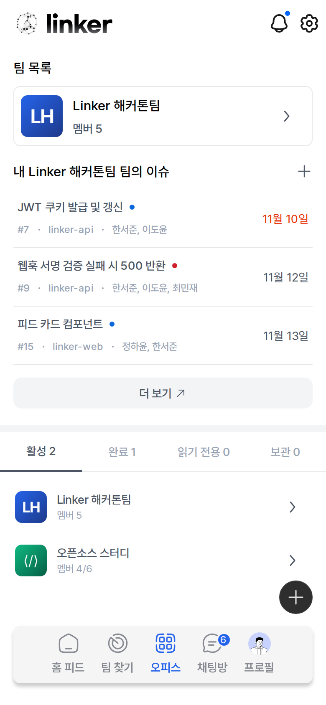</td>
  </tr>
  <tr>
    <td align="center"><b>모집글 목록</b><br /><sub>전체 · 내 모집글 · 내 지원</sub></td>
    <td align="center"><b>모집 상세</b><br /><sub>모집 역할 · 팀원 프로필 · 지원자 검토</sub></td>
    <td align="center"><b>오피스</b><br /><sub>내 팀 · 내 이슈 · 팀 상태별 목록</sub></td>
  </tr>
</table>

### 🧩 GitHub 협업 — 이슈 · 보드 · 캘린더

GitHub App으로 연결한 조직의 이슈를 Linker에서 바로 작성하고 관리합니다. 담당자·라벨·상태·일정을 바꾸면 GitHub에 그대로 반영되고, GitHub에서 바꾼 값도 웹훅으로 돌아옵니다.

<table>
  <tr>
    <td align="center" width="25%">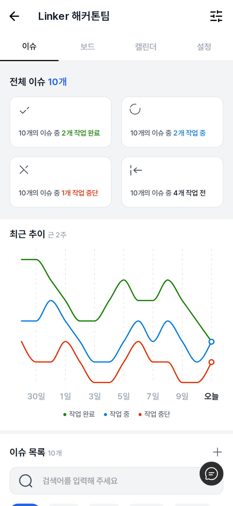</td>
    <td align="center" width="25%">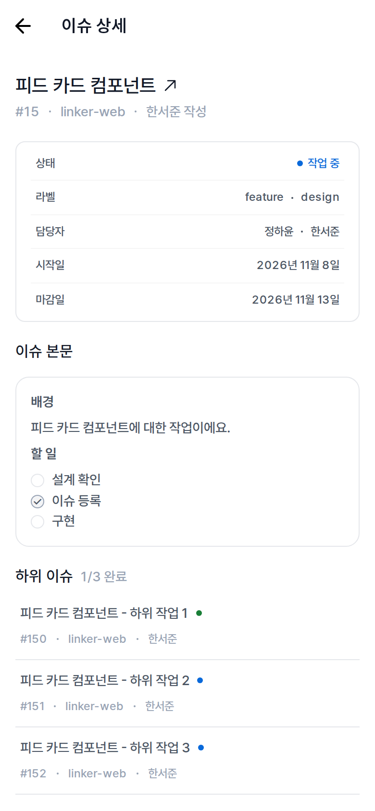</td>
    <td align="center" width="25%">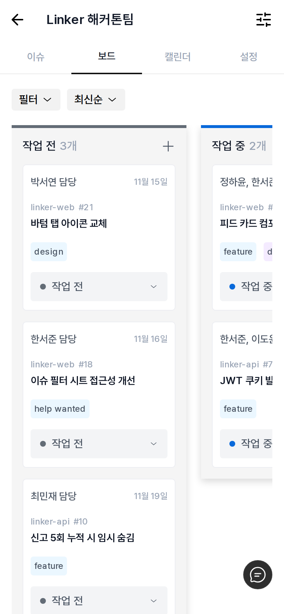</td>
    <td align="center" width="25%">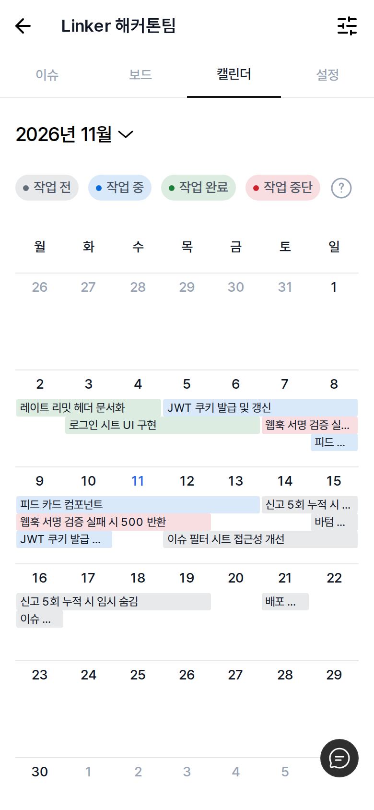</td>
  </tr>
  <tr>
    <td align="center"><b>이슈 현황</b><br /><sub>상태별 집계 · 최근 2주 추이</sub></td>
    <td align="center"><b>이슈 상세</b><br /><sub>상태·라벨·담당자·일정 · 하위 이슈</sub></td>
    <td align="center"><b>상태 보드</b><br /><sub>드래그 · 키보드로 상태 변경</sub></td>
    <td align="center"><b>캘린더</b><br /><sub>기간 막대 · 날짜별 이슈</sub></td>
  </tr>
</table>

### 💬 실시간 채팅 · 🤖 AI 채팅 요약

팀 채팅·개인 대화·메시지 요청을 WebSocket(STOMP)으로 주고받습니다. 이슈 카드·PR 안내·사진을 채팅에서 바로 공유합니다. **Flex 팀**은 쌓인 대화를 AI가 한 문단으로 요약해 주고, 요약을 채팅창에 공유할 수 있습니다.

<table>
  <tr>
    <td align="center" width="25%">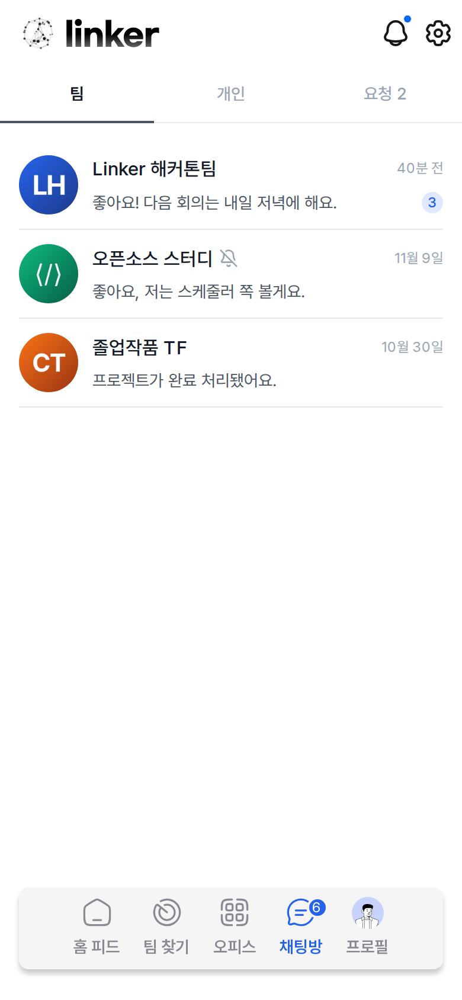</td>
    <td align="center" width="25%">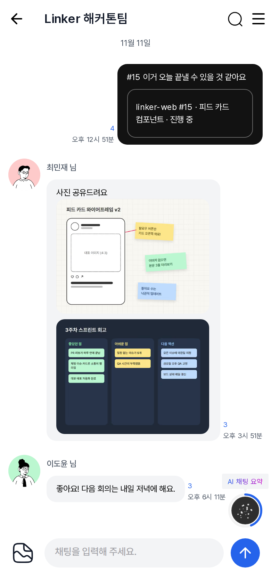</td>
    <td align="center" width="25%">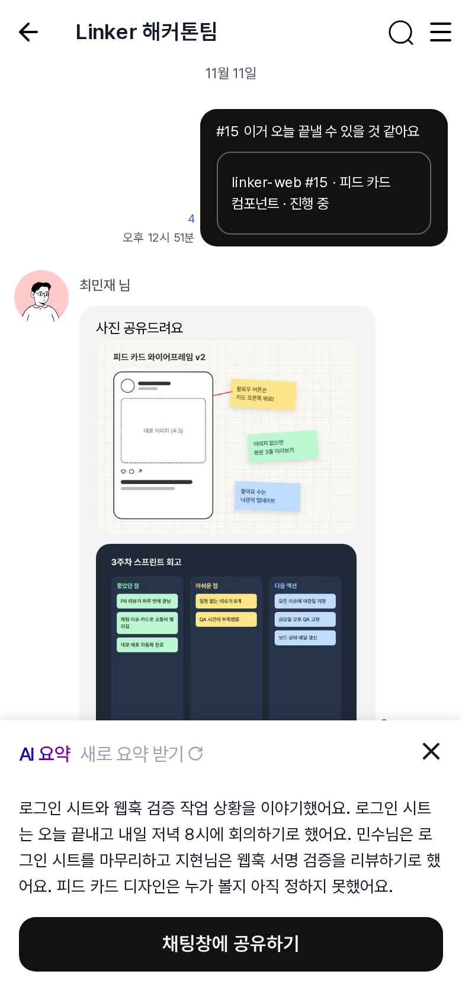</td>
    <td align="center" width="25%">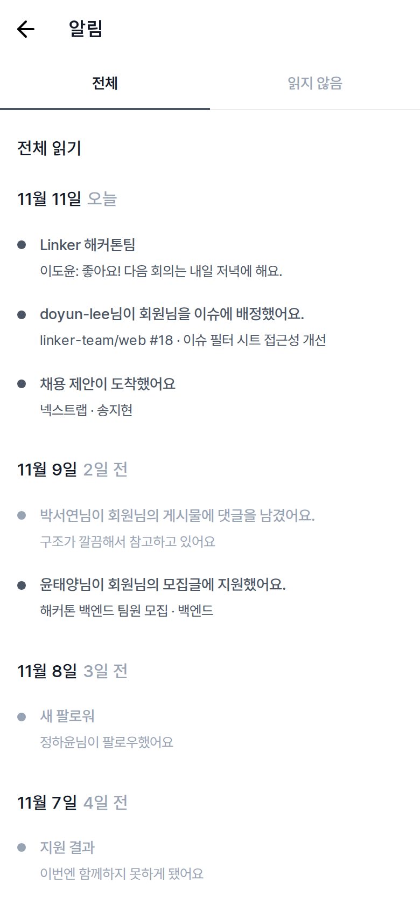</td>
  </tr>
  <tr>
    <td align="center"><b>채팅 목록</b><br /><sub>팀 · 개인 · 요청</sub></td>
    <td align="center"><b>팀 채팅방</b><br /><sub>이슈 카드 · 사진 · 읽음 수 · 요약 진행 링</sub></td>
    <td align="center"><b>AI 요약</b><br /><sub>한 문단 요약 · 채팅창에 공유</sub></td>
    <td align="center"><b>알림</b><br /><sub>인앱 알림 · Android 푸시</sub></td>
  </tr>
</table>

### 👤 프로필 · 작업물 피드

완료한 프로젝트와 작업물이 프로필에 쌓이고, 피드에서 좋아요·댓글·팔로우로 이어집니다. 작업물에는 레포·내 역할·기간·팀 규모가 함께 남습니다.

<table>
  <tr>
    <td align="center" width="33%">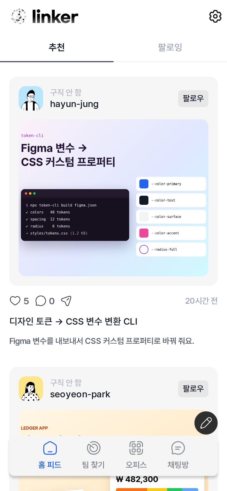</td>
    <td align="center" width="33%">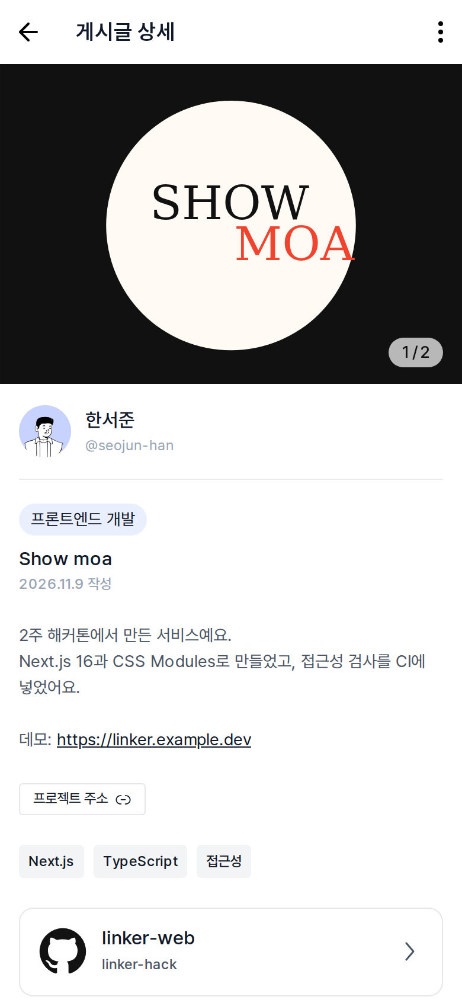</td>
    <td align="center" width="33%">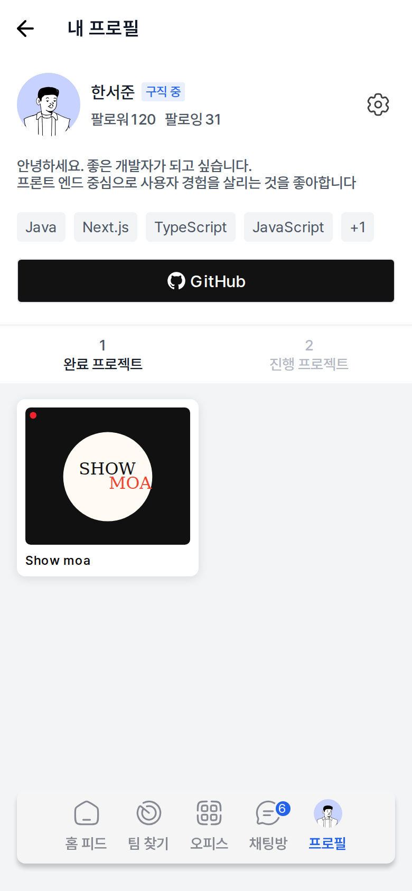</td>
  </tr>
  <tr>
    <td align="center"><b>홈 피드</b><br /><sub>추천 · 팔로잉</sub></td>
    <td align="center"><b>작업물 상세</b><br /><sub>사진 · 레포 · 기술 태그 · 좋아요/댓글</sub></td>
    <td align="center"><b>프로필</b><br /><sub>기술 스택 · 완료/진행 프로젝트</sub></td>
  </tr>
</table>

### 💳 구독 · 🤝 리크루팅 · 📈 통계

Pro/Flex/Scout 구독은 Toss Payments **테스트 모드**로 결제합니다. Pro는 작업물 유입 통계를, 채용 담당자는 채용 제안과 응답 상태를 확인합니다.

<table>
  <tr>
    <td align="center" width="25%">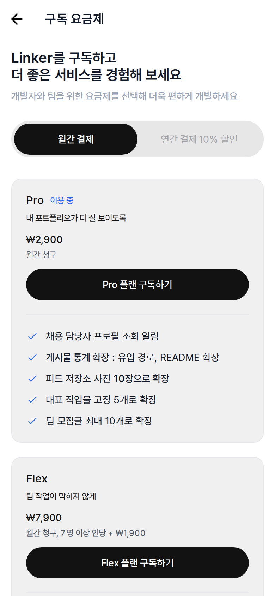</td>
    <td align="center" width="25%">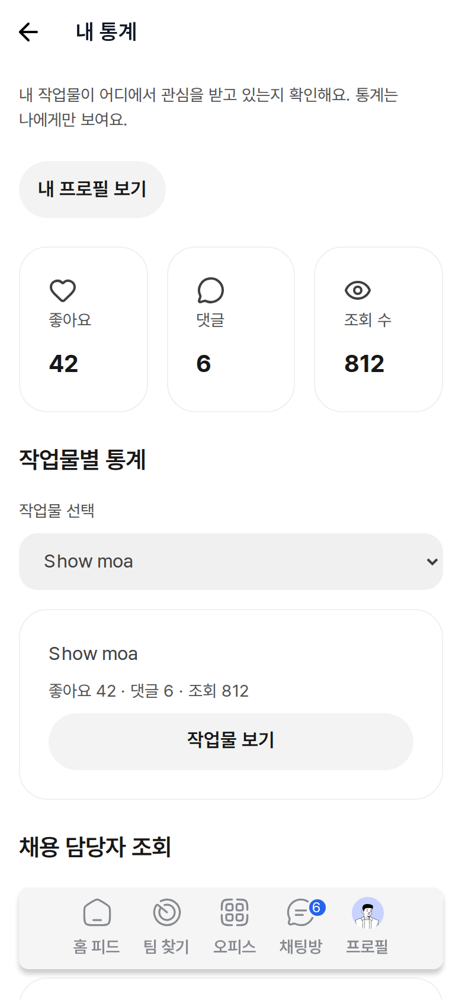</td>
    <td align="center" width="25%">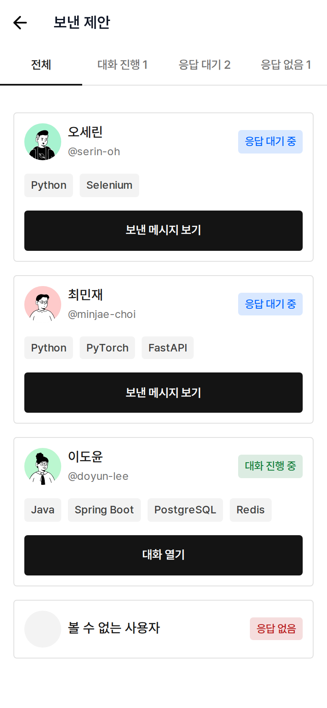</td>
    <td align="center" width="25%">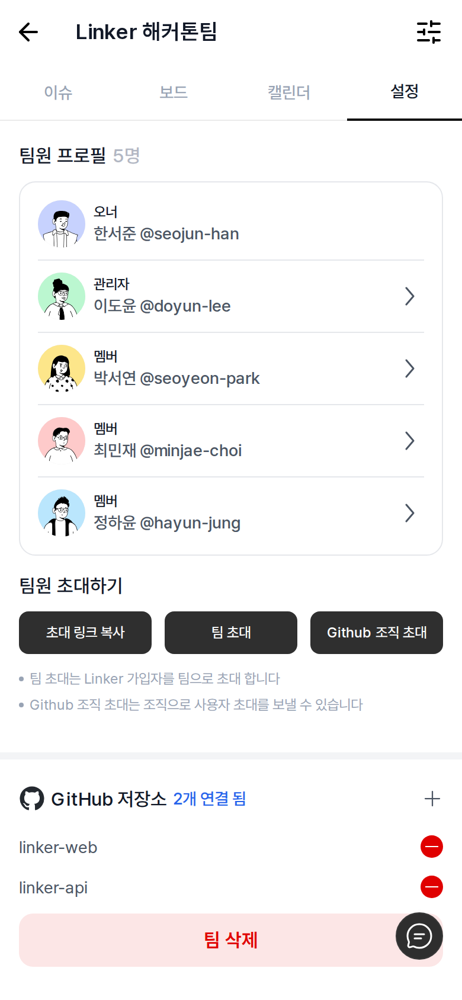</td>
  </tr>
  <tr>
    <td align="center"><b>구독 요금제</b><br /><sub>월간 · 연간 결제</sub></td>
    <td align="center"><b>내 통계</b><br /><sub>좋아요 · 댓글 · 조회 · 채용 담당자 조회</sub></td>
    <td align="center"><b>보낸 채용 제안</b><br /><sub>대화 진행 · 응답 대기 · 응답 없음</sub></td>
    <td align="center"><b>팀 설정</b><br /><sub>팀원 권한 · 초대 · 연결 저장소</sub></td>
  </tr>
</table>

<br />

## 🧭 사용자 흐름과 역할

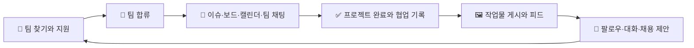

| 역할 | 가입 방식 | 할 수 있는 일 |
| --- | --- | --- |
| 비회원 | — | 피드·게시글·모집글·프로필 읽기. 쓰기·반응·지원·대화에는 로그인 필요 |
| 개발자 | GitHub 로그인 | 팀 활동·소셜 기능 전체 |
| 채용 담당자 | 기업 이메일 | 개발자에게 채용 제안 보내기 |
| 운영자 | 개발자 계정 + 운영 권한 + OTP | 신고와 이용 상태 관리 |

<details>
<summary>영역별 주요 경로 보기</summary>

<br />

| 영역 | 주요 기능 | 주요 경로 |
| --- | --- | --- |
| 팀 찾기 | 모집글 작성·검색 조건·지원·지원자 검토·수락/거절 | `/recruits` |
| 워크스페이스 | GitHub 조직과 팀 연결, 레포·멤버·초대·프로젝트 완료 관리 | `/workspace`, `/teams/[id]/settings` |
| 협업 | GitHub 이슈 작성·담당자·라벨·상태·일정, 보드와 캘린더 | `/teams/[id]/issues`, `/teams/[id]/board`, `/teams/[id]/calendar` |
| 채팅·알림 | 팀/개인 대화, 메시지 요청, PR 안내, 인앱 알림 | `/chats`, `/notifications` |
| 프로필·소셜 | 기술 스택, GitHub 기여, 완료 기록, 작업물·피드·좋아요·댓글·팔로우 | `/user/[login]`, `/posts/[id]`, `/feed` |
| 리크루팅 | 기업 이메일 가입, 구직 상태 확인, 채용 제안과 보낸 제안 목록 | `/recruiter/signup`, `/recruiter/offers` |
| 구독·운영 | Pro/Flex/Scout 구독, 통계, 신고·회원·운영 조치 기록 | `/subscribe`, `/me/stats`, `/admin/*` |

</details>

역할별 접근 권한, 팀 오너/관리자/멤버 권한, 수치와 예외는 [서비스 정책](docs/planning/04-policy.md)을 기준으로 합니다.

<br />

## 📊 구현 현황

5명이 2주 동안 개발한 포트폴리오 MVP입니다. 모바일 우선 반응형 웹과 같은 화면을 쓰는 Expo WebView 개발 빌드가 대상이며, 앱스토어 출시는 범위에 넣지 않았습니다.

<table>
  <tr>
    <td align="center" width="16%"><h3>33</h3><sub>화면</sub></td>
    <td align="center" width="16%"><h3>187</h3><sub>REST 매핑<br />(설계 205)</sub></td>
    <td align="center" width="16%"><h3>29</h3><sub>HTTP 컨트롤러</sub></td>
    <td align="center" width="16%"><h3>18</h3><sub>업무 시스템</sub></td>
    <td align="center" width="16%"><h3>64</h3><sub>엔티티<br />(설계 69)</sub></td>
    <td align="center" width="16%"><h3>V28</h3><sub>Flyway<br />마이그레이션</sub></td>
  </tr>
</table>

2026-11-11 저장소·운영 확인 기준:

- **운영 배포** — https://linker.newlecture.com 에서 서비스 중입니다. `dev → main` 병합이 GitHub Actions 자동 배포를 시작하며, 백엔드 → 웹 순서의 무중단 롤링 교체로 반영됩니다.
- **프론트엔드** — 01~33 화면의 `[Required]` 기능이 실제 API에 연결돼 있습니다. 목업 모드는 백엔드 없이 화면을 확인할 때만 씁니다.
- **백엔드** — Spring Security(GitHub 로그인·JWT httpOnly 쿠키·운영 OTP), WebSocket·STOMP 채팅, springdoc OpenAPI가 동작합니다.
- **외부 연동** — GitHub App 설치·웹훅(이슈·PR·팀)·동기화, Toss Payments 테스트 결제·해지·환불, 서버 디스크 이미지 저장소, Expo 푸시(Android), 메일(로컬은 Mailpit)이 연결돼 있습니다. 운영 메일은 아직 설정하지 않아 채용 담당자 가입은 이번 배포에서 빠졌습니다.
- **AI 채팅 요약** — Flex 팀 채팅을 운영 서버의 Ollama `qwen3:4b`(2 CPU / 4 GiB, GPU 없음)로 요약합니다.
- `[Included]` 항목은 일부만 구현했습니다. 범위 선택 요약, 요약 할 일 → 이슈 만들기 등은 후속 범위입니다.

전체 기획 범위는 [MVP 정의](docs/planning/03-mvp-definition.md), 페이지별 완료 조건은 [페이지 TODO](docs/planning/07-page-todo.md)를 참고하세요. WBS의 **33개 페이지·18개 업무 시스템·29개 컨트롤러·205개 REST 엔드포인트·69개 테이블**은 설계 규모입니다.

<br />

## 🛠 기술 스택

| 구분 | 기술 |
| --- | --- |
| **웹** |      |
| **상태·API** |    -6BA539?style=flat-square&logo=openapiinitiative&logoColor=white) |
| **앱** |   |
| **서버** |       |
| **실시간·AI** |   |
| **데이터·인프라** |     |
| **외부 연동** |  -0064FF?style=flat-square&logo=toss&logoColor=white)  |
| **테스트·배포** |       |

<br />

## 🏗 아키텍처

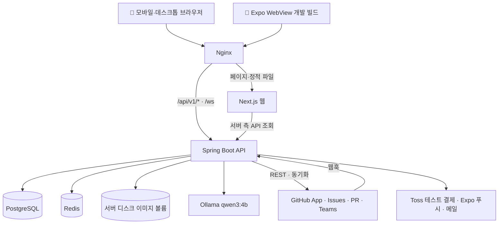

| 구성 | 설명 |
| --- | --- |
| **웹과 앱** | 화면은 Next.js에서 구현합니다. Expo는 WebView로 같은 웹을 열고, 로그인 복귀·공유·Android 뒤로가기·푸시를 네이티브 브리지로 연결합니다. |
| **요청 분기** | Nginx가 웹, `/api/v1/*` REST, `/ws`(STOMP), `/files/*`(업로드 이미지)를 나눕니다. Next.js 서버 측 요청은 컨테이너 내부 Spring 주소를 씁니다. Ollama는 공개 도메인에 연결하지 않고 백엔드만 내부 네트워크로 호출합니다. |
| **비동기 작업** | 알림·웹훅 처리·만료/정리 스케줄은 `async` 패키지에서 처리합니다. AI 요약은 단일 작업자 대기열에서 처리하고 진행률은 Redis에 둡니다. |

<br />

## 🔍 핵심 설계 포인트

<details open>
<summary><b>1. GitHub를 원본으로, Linker는 사본을 읽는다</b></summary>

<br />

조직·레포·이슈·PR의 원본은 GitHub입니다. Linker는 **GitHub App 웹훅(서명 검증)** 과 **주기적 동기화**로 DB 사본을 유지하고, 화면은 이 사본을 읽습니다. Linker에서 만든 이슈는 사용자 본인 이름으로 GitHub에 생성됩니다. 채팅·지원·게시글·구독·운영 기록만 Linker가 직접 관리합니다. 팀은 GitHub 사용 습관을 그대로 유지할 수 있습니다.

</details>

<details>
<summary><b>2. JWT는 JavaScript와 네이티브 어디에도 노출하지 않는다</b></summary>

<br />

JWT는 상위 도메인의 **httpOnly 쿠키**에만 둡니다. 실제 권한은 Spring이 검증하고, 브라우저 JavaScript나 WebView 네이티브 브리지로는 토큰을 전달하지 않습니다. 네이티브 쪽은 `userId`·`userType`만 저장합니다.

</details>

<details>
<summary><b>3. GPU 없는 서버에서 AI 요약 돌리기</b></summary>

<br />

운영 서버는 GPU 없이 2 CPU / 4 GiB로 Ollama `qwen3:4b`를 실행합니다. 요약 1회에 2~3분이 걸려서, 요청은 **단일 작업자 대기열**에 넣고 진행 단계(대기 → 읽는 중 → 쓰는 중)와 진행률을 Redis에 기록합니다. 화면에서는 **진행 링**으로 상태를 보여 주고, 끝나면 토스트로 알립니다.

</details>

<details>
<summary><b>4. OpenAPI 계약과 목업 모드로 프론트·백엔드를 동시에 개발</b></summary>

<br />

springdoc이 만든 OpenAPI(`/v3/api-docs`)를 orval로 변환해 프론트엔드 API 클라이언트를 생성합니다. 백엔드가 준비되기 전에는 `apiFetch`가 Spring 대신 `mocks/`에서 응답을 받는 **목업 모드**로 화면을 먼저 만들었습니다. 일반 빌드에는 목업 코드가 들어가지 않습니다.

</details>

<details>
<summary><b>5. 무중단 롤링 배포</b></summary>

<br />

`dev → main` 병합 시 웹·백엔드 이미지를 GHCR에 올리고, 서버에서 **백엔드 → 웹 순서로 롤링 교체**합니다. 내부 상태 검사와 외부 HTTPS 검사를 통과하지 못하면 기존 컨테이너를 유지하거나 이전 이미지로 되돌립니다.

</details>

<br />

## 👥 팀 소개

**한 사람이 담당 페이지의 프론트엔드와 백엔드를 함께 맡았습니다.** 페이지·컨트롤러·API의 소유자는 [WBS](docs/development/02-wbs.md)를 기준으로 합니다.

<table>
  <tr>
    <td align="center" width="20%"><a href="https://github.com/OMS-cc"><br /><b>OMS-cc</b></a><br /><sub><b>A</b> · 계정·프로필·신고·리크루팅</sub></td>
    <td align="center" width="20%"><a href="https://github.com/D-Gyun103"><br /><b>D-Gyun103</b></a><br /><sub><b>B</b> · GitHub 연동·팀·운영·통계</sub></td>
    <td align="center" width="20%"><a href="https://github.com/jangabc3"><br /><b>jangabc3</b></a><br /><sub><b>C</b> · 이슈·보드·캘린더</sub></td>
    <td align="center" width="20%"><a href="https://github.com/Yunsu0407"><br /><b>Yunsu0407</b></a><br /><sub><b>D</b> · 채팅·알림·구독·AI 요약</sub></td>
    <td align="center" width="20%"><a href="https://github.com/JUNHORANG"><br /><b>JUNHORANG</b></a><br /><sub><b>E</b> · 팀 찾기·모집·작업물·피드</sub></td>
  </tr>
</table>

| 구분 | 담당 페이지 | 주요 구현·협업 영역 |
| --- | --- | --- |
| A | 01~06, 25, 31~33 | 인증/온보딩, 프로필, 운영 OTP, 채용 담당자 계정 |
| B | 07~10, 26, 27, 30 | 17의 PR 안내/목록, WebView 브리지·배포 기반 |
| C | 11~15 | 07의 내 이슈, 11의 Flex 진행 현황 |
| D | 16~18, 28, 29 | STOMP, 메시지 요청/채용 제안, 결제·혜택·해지/환불, 17의 Flex AI 요약(2026-11-10 C에서 인계) |
| E | 19~24 | 지원/수락, 게시글·소셜, 공통 시트·이미지 업로드 |

00 공통 기반은 전원이 나눠 맡았습니다. A는 인증·접근 제어, B는 GitHub App·네이티브 브리지·인프라, C는 정책 상수·SEO·테스트, D는 STOMP·알림·제한 정책, E는 모노레포·API 호출·공통 UI를 담당했습니다.

### 협업 방식

| 기간 | 목표 |
| --- | --- |
| **D1~D2** | 공통 기반과 GitHub 로그인/설치·Projects·웹훅·STOMP·테스트 결제의 위험 구간을 먼저 검증 |
| **D3~D5** | 로그인 → 온보딩 → 팀 생성 → 이슈 → 팀 채팅 연결 |
| **D6~D9** | 모집/지원/합류 → 프로젝트 완료 → 작업물 → 피드/대화 → 구독/운영으로 확장 |
| **D10** | `[Required]` 완료 조건, 모바일/WebView, 권한·예외·재시도와 팀 간 연결 통합 검증 |

다른 페이지의 API는 원래 담당자의 것을 재사용합니다. 팀 합류는 B·D·E, PR 안내는 B·D, 이슈/AI 요약은 B·C·D, 프로필/대표 작업물/통계는 A·B·E, 구독 혜택은 D와 각 화면 담당자가 함께 확인했습니다.

<details>
<summary><b>Git 규칙</b></summary>

<br />

- 최신 `dev`에서 `feat/`, `fix/`, `chore/`, `docs/` 브랜치를 만들어 작업합니다.
- 커밋은 `<type>: <한국어 설명>`, PR은 작업 브랜치 → `dev`로 올리고 CI(`ci-result`) 통과와 리뷰 후 스쿼시 병합합니다.
- `main`·`dev`에 직접 커밋하지 않으며, `dev → main` 병합이 운영 배포입니다.
- 에이전트(Claude, Cursor, Codex 등)의 공동 작성자·생성 표시는 커밋·PR·코드·문서 어디에도 넣지 않습니다. `frontend`에서 `pnpm install`(또는 `bash scripts/setup-git-hooks.sh`)을 실행하면 `commit-msg` 훅이 이런 줄을 지우고, CI `pr-rules`가 PR 제목·본문·커밋과 브랜치 이름 형식을 검사합니다.

</details>

<details>
<summary><b>GitHub 작업 이슈 (담당자별 12개 · 페이지별 72개)</b></summary>

<br />

프론트엔드는 기존 목업 화면의 보완·실제 API 연동·최종 검증을, 백엔드는 공통 기반과 WBS API/도메인 구현을 추적합니다. 기능을 전부 다시 만드는 목록이 아니며, 체크 여부는 실제 완료 근거와 함께 갱신합니다.

<!-- TEAM_ISSUES_START -->

| 담당 | 프론트엔드                                                            | 백엔드                                                                |
| ---- | --------------------------------------------------------------------- | --------------------------------------------------------------------- |
| 공통 | [#48](https://github.com/likelion-backendschool-9th/Linker/issues/48) | [#49](https://github.com/likelion-backendschool-9th/Linker/issues/49) |
| A    | [#50](https://github.com/likelion-backendschool-9th/Linker/issues/50) | [#51](https://github.com/likelion-backendschool-9th/Linker/issues/51) |
| B    | [#52](https://github.com/likelion-backendschool-9th/Linker/issues/52) | [#53](https://github.com/likelion-backendschool-9th/Linker/issues/53) |
| C    | [#54](https://github.com/likelion-backendschool-9th/Linker/issues/54) | [#55](https://github.com/likelion-backendschool-9th/Linker/issues/55) |
| D    | [#56](https://github.com/likelion-backendschool-9th/Linker/issues/56) | [#57](https://github.com/likelion-backendschool-9th/Linker/issues/57) |
| E    | [#58](https://github.com/likelion-backendschool-9th/Linker/issues/58) | [#59](https://github.com/likelion-backendschool-9th/Linker/issues/59) |

<!-- TEAM_ISSUES_END -->

> 아래 이슈 본문의 `WBS 컨트롤러:`와 `LoginController`·`IssueListController` 같은 컨트롤러명은 #156 이전의 페이지별 컨트롤러 표기입니다. API 소속 시스템 컨트롤러와 경로·권한은 [WBS](docs/development/02-wbs.md) §4·§5를 따릅니다.

<!-- PAGE_ISSUE_INDEX_START -->

담당자별 이슈는 상위 추적으로 유지하고, 실행할 작업은 **페이지별 프론트엔드 36개·백엔드 36개**로 나눴습니다. 33개 페이지 중 07의 내 이슈(C), 17의 PR(B)·AI 요약(C)을 분리한 36개 작업 범위이며 새 페이지를 추가한 것이 아닙니다. 00 공통 기반은 기존 #48·#49에서 담당자별로 관리합니다.

각 세부 이슈에는 화면/도메인 체크리스트, 권한·입력 제한·예외, WBS API와 관련 테이블, 협업/상대 FE·BE 링크, 완료 검증과 근거 문서가 있습니다. `[Included]`는 핵심 `[Required]` 이후 진행합니다.

| 페이지 | 담당 | 작업                                                | 프론트엔드                                                              | 백엔드                                                                  |
| ------ | ---- | --------------------------------------------------- | ----------------------------------------------------------------------- | ----------------------------------------------------------------------- |
| 01     | A    | 시작 화면·GitHub 로그인                             | [#62](https://github.com/likelion-backendschool-9th/Linker/issues/62)   | [#63](https://github.com/likelion-backendschool-9th/Linker/issues/63)   |
| 02     | A    | 온보딩·동의·기본 프로필                             | [#64](https://github.com/likelion-backendschool-9th/Linker/issues/64)   | [#65](https://github.com/likelion-backendschool-9th/Linker/issues/65)   |
| 03     | A    | 약관·개인정보·정책 문서 뷰어                        | [#66](https://github.com/likelion-backendschool-9th/Linker/issues/66)   | [#67](https://github.com/likelion-backendschool-9th/Linker/issues/67)   |
| 04     | A    | 프로필·팔로우·작업물·채용 담당자 마이페이지         | [#68](https://github.com/likelion-backendschool-9th/Linker/issues/68)   | [#69](https://github.com/likelion-backendschool-9th/Linker/issues/69)   |
| 05     | A    | 프로필 수정·GitHub 다시 불러오기                    | [#70](https://github.com/likelion-backendschool-9th/Linker/issues/70)   | [#72](https://github.com/likelion-backendschool-9th/Linker/issues/72)   |
| 06     | A    | 설정·알림 설정·차단·탈퇴                            | [#73](https://github.com/likelion-backendschool-9th/Linker/issues/73)   | [#74](https://github.com/likelion-backendschool-9th/Linker/issues/74)   |
| 07     | B    | 워크스페이스·팀 목록·팀 전환                        | [#75](https://github.com/likelion-backendschool-9th/Linker/issues/75)   | [#76](https://github.com/likelion-backendschool-9th/Linker/issues/76)   |
| 07-my  | C    | 내 이슈 목록 `[Included]`                           | [#77](https://github.com/likelion-backendschool-9th/Linker/issues/77)   | [#78](https://github.com/likelion-backendschool-9th/Linker/issues/78)   |
| 08     | B    | GitHub App 설치·팀 생성 5단계                       | [#79](https://github.com/likelion-backendschool-9th/Linker/issues/79)   | [#80](https://github.com/likelion-backendschool-9th/Linker/issues/80)   |
| 09     | B    | 팀 설정·멤버·소유권·완료 관리                       | [#81](https://github.com/likelion-backendschool-9th/Linker/issues/81)   | [#82](https://github.com/likelion-backendschool-9th/Linker/issues/82)   |
| 10     | B    | 초대 링크 확인·팀 참여                              | [#83](https://github.com/likelion-backendschool-9th/Linker/issues/83)   | [#84](https://github.com/likelion-backendschool-9th/Linker/issues/84)   |
| 11     | C    | 이슈 목록·필터·일정 없음·진행 현황                  | [#85](https://github.com/likelion-backendschool-9th/Linker/issues/85)   | [#86](https://github.com/likelion-backendschool-9th/Linker/issues/86)   |
| 12     | C    | 이슈 상세·담당자/라벨/일정/상태 시트                | [#87](https://github.com/likelion-backendschool-9th/Linker/issues/87)   | [#88](https://github.com/likelion-backendschool-9th/Linker/issues/88)   |
| 13     | C    | 이슈 작성·템플릿·생성 진행/복구                     | [#89](https://github.com/likelion-backendschool-9th/Linker/issues/89)   | [#90](https://github.com/likelion-backendschool-9th/Linker/issues/90)   |
| 14     | C    | 상태 보드·드래그·키보드 상태 변경                   | [#91](https://github.com/likelion-backendschool-9th/Linker/issues/91)   | [#92](https://github.com/likelion-backendschool-9th/Linker/issues/92)   |
| 15     | C    | 캘린더·기간 막대·날짜별 이슈                        | [#93](https://github.com/likelion-backendschool-9th/Linker/issues/93)   | [#94](https://github.com/likelion-backendschool-9th/Linker/issues/94)   |
| 16     | D    | 채팅 목록·메시지 요청                               | [#95](https://github.com/likelion-backendschool-9th/Linker/issues/95)   | [#96](https://github.com/likelion-backendschool-9th/Linker/issues/96)   |
| 17     | D    | 팀·개인 채팅·사진·메시지 메뉴·공유                  | [#97](https://github.com/likelion-backendschool-9th/Linker/issues/97)   | [#98](https://github.com/likelion-backendschool-9th/Linker/issues/98)   |
| 17-pr  | B    | 채팅 PR 목록·시스템 메시지                          | [#99](https://github.com/likelion-backendschool-9th/Linker/issues/99)   | [#100](https://github.com/likelion-backendschool-9th/Linker/issues/100) |
| 17-ai  | C→D  | Flex AI 채팅 요약 `[Included]` (2026-11-10 D 인계)  | [#101](https://github.com/likelion-backendschool-9th/Linker/issues/101) | [#102](https://github.com/likelion-backendschool-9th/Linker/issues/102) |
| 18     | D    | 알림 목록·읽음·이의 제기·Android 푸시               | [#103](https://github.com/likelion-backendschool-9th/Linker/issues/103) | [#104](https://github.com/likelion-backendschool-9th/Linker/issues/104) |
| 19     | E    | 모집글 목록·필터·내 모집/지원                       | [#105](https://github.com/likelion-backendschool-9th/Linker/issues/105) | [#106](https://github.com/likelion-backendschool-9th/Linker/issues/106) |
| 20     | E    | 모집글 작성·수정·마감/재개                          | [#107](https://github.com/likelion-backendschool-9th/Linker/issues/107) | [#108](https://github.com/likelion-backendschool-9th/Linker/issues/108) |
| 21     | E    | 모집 상세·지원·지원자 검토/수락                     | [#109](https://github.com/likelion-backendschool-9th/Linker/issues/109) | [#110](https://github.com/likelion-backendschool-9th/Linker/issues/110) |
| 22     | E    | 작업물 작성·레포/사진·초안                          | [#111](https://github.com/likelion-backendschool-9th/Linker/issues/111) | [#112](https://github.com/likelion-backendschool-9th/Linker/issues/112) |
| 23     | E    | 작업물 상세·좋아요/댓글·유입 기록                   | [#113](https://github.com/likelion-backendschool-9th/Linker/issues/113) | [#114](https://github.com/likelion-backendschool-9th/Linker/issues/114) |
| 24     | E    | 홈 피드·추천·광고 카드                              | [#115](https://github.com/likelion-backendschool-9th/Linker/issues/115) | [#116](https://github.com/likelion-backendschool-9th/Linker/issues/116) |
| 25     | A    | 운영 신고·조치·이의 제기                            | [#117](https://github.com/likelion-backendschool-9th/Linker/issues/117) | [#118](https://github.com/likelion-backendschool-9th/Linker/issues/118) |
| 26     | B    | 운영 회원·제재·이메일 열람·환불                     | [#119](https://github.com/likelion-backendschool-9th/Linker/issues/119) | [#120](https://github.com/likelion-backendschool-9th/Linker/issues/120) |
| 27     | B    | 운영 조치 기록·기간/운영자 필터                     | [#121](https://github.com/likelion-backendschool-9th/Linker/issues/121) | [#122](https://github.com/likelion-backendschool-9th/Linker/issues/122) |
| 28     | D    | 요금제·Toss 테스트 결제·승인 결과                   | [#123](https://github.com/likelion-backendschool-9th/Linker/issues/123) | [#124](https://github.com/likelion-backendschool-9th/Linker/issues/124) |
| 29     | D    | 구독 관리·해지·환불·만료/유예                       | [#125](https://github.com/likelion-backendschool-9th/Linker/issues/125) | [#126](https://github.com/likelion-backendschool-9th/Linker/issues/126) |
| 30     | B    | 내 통계·Pro 유입/채용 조회·대표 작업물 `[Included]` | [#127](https://github.com/likelion-backendschool-9th/Linker/issues/127) | [#128](https://github.com/likelion-backendschool-9th/Linker/issues/128) |
| 31     | A    | 채용 담당자 가입·회사 이메일 인증 `[Included]`      | [#129](https://github.com/likelion-backendschool-9th/Linker/issues/129) | [#130](https://github.com/likelion-backendschool-9th/Linker/issues/130) |
| 32     | A    | 채용 담당자 로그인·비밀번호 재설정 `[Included]`     | [#131](https://github.com/likelion-backendschool-9th/Linker/issues/131) | [#132](https://github.com/likelion-backendschool-9th/Linker/issues/132) |
| 33     | A    | 보낸 채용 제안 목록·요약·첫 메시지 `[Included]`     | [#133](https://github.com/likelion-backendschool-9th/Linker/issues/133) | [#134](https://github.com/likelion-backendschool-9th/Linker/issues/134) |

<!-- PAGE_ISSUE_INDEX_END -->

</details>

<br />

## 🚀 시작하기

### 1. 화면만 빠르게 보기 (목업 모드)

> **필요한 것:** Node.js 22 이상, pnpm 10.15.0 (CI는 Node.js 24)

```bash
npm install -g pnpm@10.15.0   # pnpm이 없는 경우 최초 1회

cd frontend
pnpm install --frozen-lockfile
pnpm dev:mock
```

**http://localhost:3000** 에 접속합니다. 화면 왼쪽 아래 **목업 계정**에서 비회원·개발자·신규 가입자·채용 담당자·운영자로 전환할 수 있습니다.

> [!NOTE]
> 목업 로그인은 실제 GitHub 인증이 아닙니다. 일반 목업 데이터는 서버와 브라우저가 별도 메모리에 보관하므로 브라우저에서 만든 항목을 서버가 조회하지 못할 수 있습니다. 결제·구독 목업 일부는 브라우저 세션 저장소를 사용합니다.

### 2. 웹·서버·DB·Redis 함께 실행 (Docker)

> **필요한 것:** Docker, Docker Compose. 최초 실행 시 루트 `.env.example`을 바탕으로 `.env`의 `DB_PASSWORD`를 설정합니다(기존 `.env`는 유지).

```bash
# 저장소 루트에서
docker compose up -d --build --wait --wait-timeout 240
docker compose ps
```

**http://localhost:8000** (`PROXY_PORT`로 변경)에 접속합니다. Docker 빌드는 목업 없이 실제 백엔드에 연결합니다.

- GitHub 로그인·웹훅에는 `.env`의 GitHub App 값이 필요합니다 → [GitHub App 안내](docs/operations/06-github-app.md)
- 로컬 메일 확인용 Mailpit은 `compose.dev.yml`에 있습니다.
- 소스 자동 반영·Compose 버전 조건 → [Docker 실행 가이드](docs/operations/02-docker.md) · DB 도구 접속 → [로컬 DB 안내](docs/operations/05-database-access.md)

<details>
<summary><b>AI 채팅 요약(Ollama) 로컬 실행</b></summary>

<br />

Ollama를 따로 실행하고 백엔드와 같은 Docker 네트워크에 연결합니다. 모델은 `qwen3:4b`이며 절차는 [Ollama 안내](deploy/ollama/README.md)를 따릅니다.

```bash
docker compose --env-file /dev/null -f deploy/ollama/compose.yml up -d --wait
```

</details>

<details>
<summary><b>Expo 실기기 실행</b></summary>

<br />

`frontend/apps/mobile/.env.example`의 웹 주소를 개발 PC의 LAN IP로 설정하고 개발 빌드를 사용합니다. 상세 절차는 [프론트엔드 청사진](docs/development/03-frontend-blueprint.md)의 앱·브리지 항목을 따릅니다.

</details>

### 3. 검증

```bash
cd frontend
pnpm lint && pnpm typecheck && pnpm test && pnpm build
```

백엔드는 PostgreSQL·Redis와 DB 환경변수를 준비한 뒤 `backend`에서 `./gradlew build`로 검증합니다. PR마다 GitHub Actions가 변경 영역의 프론트엔드·백엔드 검사를 실행하고, 결과를 `ci-result` 하나로 모읍니다.

<br />

## 📦 배포

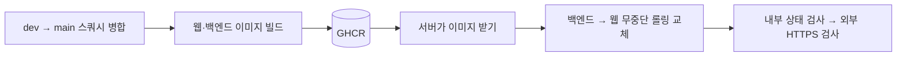

| 항목 | 내용 |
| --- | --- |
| 운영 주소 | https://linker.newlecture.com |
| 트리거 | `dev → main` PR 스쿼시 병합 시 GitHub Actions `deploy` 실행 |
| 교체 방식 | 백엔드 → 웹 순서 무중단 롤링 교체. 실패하면 기존 컨테이너 유지 또는 이전 이미지로 복구 |
| 서버 구성 | 호스트 Nginx(HTTPS) → Docker Nginx → 웹·백엔드, PostgreSQL·Redis·업로드 볼륨, 별도 Ollama 컨테이너 |

절차와 서버 설정은 [서버 운영](docs/operations/03-deployment.md)과 [자동 배포](docs/operations/04-automatic-deployment.md)를 따릅니다.

<br />

## 📁 저장소 구조와 문서

```text
Linker/
├── frontend/
│   ├── apps/web/          # Next.js 화면·공통 UI·목업·테스트
│   ├── apps/mobile/       # Expo WebView 개발 빌드
│   └── packages/          # api, bridge, config 공용 패키지
├── backend/               # Spring Boot / com.linker.backend
├── docs/
│   ├── planning/          # 서비스 기획·PRD·MVP·정책·페이지 TODO
│   ├── development/       # ERD·WBS·프론트/백엔드 청사진·디자인
│   └── operations/        # 로컬 설정·Docker·서버·자동 배포·GitHub App
├── nginx/                 # 로컬·운영 프록시와 호스트 설정 예시
├── deploy/                # 이미지 배포·롤링 교체 스크립트, ollama/ AI 모델 실행 구성
├── scripts/               # 저장소·배포 구성 검증 도구
├── compose*.yml           # 기본·개발·운영·이미지 실행 구성
└── .github/               # CI·배포·PR/이슈 템플릿
```

| 문서 | 확인할 내용 |
| --- | --- |
| [서비스 기획](docs/planning/01-service-plan.md) · [PRD](docs/planning/02-prd.md) | 서비스 방향·사용자 흐름·기능 완료 조건 |
| [MVP 정의](docs/planning/03-mvp-definition.md) · [정책](docs/planning/04-policy.md) | 포함/제외 범위·역할·수치·상태·예외·UI 문구 |
| [페이지 TODO](docs/planning/07-page-todo.md) | 01~33 페이지와 URL·화면 항목 |
| [ERD](docs/development/01-erd.md) · [WBS](docs/development/02-wbs.md) | 테이블·컬럼·컨트롤러·API·담당·의존성 |
| [프론트 청사진](docs/development/03-frontend-blueprint.md) · [디자인 가이드](docs/development/04-design-guide.md) | 프론트 구현 규칙·토큰·컴포넌트 스타일 |
| [백엔드 청사진](docs/development/05-backend-blueprint.md) | 서버 도메인·보안·트랜잭션·연동 설계와 미확정 제안 |
| [저장소 설정](docs/operations/01-setup.md) · [Docker](docs/operations/02-docker.md) | 개발 환경·CI·로컬 컨테이너 실행 |
| [서버 운영](docs/operations/03-deployment.md) · [자동 배포](docs/operations/04-automatic-deployment.md) | 운영 구성·HTTPS·main 배포 초기 설정과 절차 |
| [로컬 DB](docs/operations/05-database-access.md) | Docker Compose 로컬 DB, `127.0.0.1:5500`, 볼륨·비밀번호 |
| [GitHub App](docs/operations/06-github-app.md) · [연동 테스트](docs/operations/07-github-integration-test.md) | App 권한·웹훅·콜백 설정과 연동 확인 절차 |
| [Ollama](deploy/ollama/README.md) | AI 요약 모델 실행·연결 정보 |

> README는 프로젝트의 입구입니다. 상세 수치·권한은 정책, 화면은 페이지 TODO, API·담당은 WBS, 데이터 구조는 ERD를 우선합니다.

<div align="center">
<br />
<sub>Made by Team Linker · 2026</sub>
</div>
