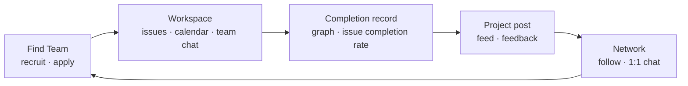
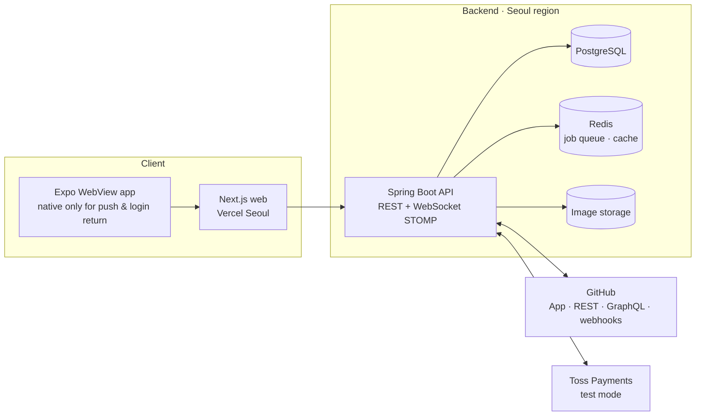

# Linker Service Plan

> Question this document answers: **How is Linker structured?**
> Why we build it and what it should achieve is in the [PRD](./02-prd.md), first-release scope in the [MVP Definition](./03-mvp-definition.md), and detailed per-feature rules in the [Policy](./04-policy.md).

## 1. Service overview

**Linker is a service for developers that connects finding a team, working with the team, and showing the result as a project post — all in one app.**

In one sentence: "LinkedIn for developers, where the way you work becomes your portfolio." Users sign up with a single GitHub account, and Linker uses GitHub organizations, repos, issues and PRs as the source of truth.

| Item | Description |
| --- | --- |
| Form | Mobile-first responsive web + a WebView app wrapping the same screens |
| Sign-up | Developers: GitHub account. Recruiters: company email |
| Core users | Junior / job-seeking developers working in side-project, bootcamp, club or hackathon teams |
| Core concept | One unbroken flow: find a team → collaborate → project post → network |
| Revenue | Individual Pro, team Flex, and recruiter Scout subscriptions (Flex and Scout are working names; portfolio project, so Toss Payments test mode). Scout shows a job ad in the feed of developers whose chosen job categories match and raises the recruiting offer limit |

## 2. User pain points and how Linker solves them

Linker starts from three frustrations that developers on team projects face. Below are the scenes users actually experience and how Linker's structure solves them. Problem definitions and target metrics are in [PRD ch. 2](./02-prd.md#2-problem-definition).

### 2-1. The workspace is scattered

**What the user experiences**

Jisu leads a side-project team. Tasks live in GitHub issues, conversation in Discord, schedules in a Notion table or Google Calendar, meeting notes in KakaoTalk. To check "who is doing what this week?" on the subway she must open four apps, and the GitHub mobile app can't show issue due dates and progress at a glance. When teammate Minho opens a PR, nobody knows until someone mentions it on Discord. Progress lives only in the leader's head, and in a week when the leader is busy, the whole team stalls.

**Why it happens**

- GitHub is the source of truth for code and issues, but its chat and scheduling are weak and the flow is hard to follow on mobile.
- Messengers are convenient for talking but aren't linked to issues/PRs, so "where did we discuss that?" keeps happening.
- Work tools like Jira or Slack are heavy for small teams, with free-tier limits and setup overhead.

**How Linker solves it**

| Scattered across | Where it comes together in Linker | Source of truth |
| --- | --- | --- |
| GitHub issues | Team home issue board and "my issues" list; write issues from templates directly on mobile | GitHub Issues |
| Notion table / Google Calendar | Team calendar; issue start and due dates shown as period bars | GitHub Projects fields |
| Discord / KakaoTalk | Team chat; share issues as cards, turn messages into issues | Linker |
| GitHub notification emails | PR opened / review requested / merged posted automatically to team chat | GitHub webhooks |

The key is **not to build yet another tool, but to keep GitHub as the source of truth and put mobile screens and conversation on top of it**. Issues written in Linker are created on GitHub under the user's own name, and values changed on GitHub come back to Linker via webhooks. Teams keep their GitHub habits and still see the flow on one screen.

### 2-2. It is hard to find teammates

**What the user experiences**

Seoyeon, a job seeker, is looking for a backend developer for a portfolio project. She posts in developer communities, open chat rooms and school boards and waits. Applicants say only "I've used Spring," so there is no way to know what code they write or whether they'll stay to the end. Even after forming a team, setup — GitHub org invites, Discord channel, sharing Notion pages — takes days. Three weeks later, one teammate silently disappears.

**Why it happens**

- Recruit posts are scattered across communities, so both sides must repost and search repeatedly.
- The only basis for judging an applicant is a few lines of self-introduction; there is no way to check their work or reliability.
- After matching, the collaboration space is separate, so getting started takes time.
- Dropping out leaves no record, so the same problem repeats in the next team.

**How Linker solves it**

| Problem | Linker's mechanism |
| --- | --- |
| Recruit posts are scattered | One Find Team tab gathers recruit posts, filterable by role, stack, online/offline |
| No basis for judging applicants | **The profile is the application.** With one short message, the tech stack, GitHub contribution graph, project posts and past project record are attached |
| Unknown whether they'll finish | **Completion record.** Profile shows the number of projects completed in Linker and the completion rate of assigned issues |
| Setup after matching is tedious | On accept: added as team member, joins team chat, and a GitHub org invite button — all at once |

The completion record is calculated only from real work data inside Linker, so it can't be faked, and it becomes the basis of trust when looking for the next team. Find Team is Linker's **entrance**, and the workspace is the **engine** where trust data accumulates.

### 2-3. No place to show work and get feedback, no place for developers to connect

**What the user experiences**

Minho finished a project and wants to share it. A GitHub repo link alone doesn't convey what was built, why, or what his role was. Blog retrospectives get few readers; general social media buries dev talk. Business social networks focus on experienced hires and job ads, leaving no room for a job seeker's side project. He wants opinions on his code but has no one to ask, and no channel to connect with developers using a similar stack.

**Why it happens**

- GitHub is a code repository, not a place to tell a story. Context (problem, role, result) is missing.
- Developer-centered social spaces are weak, so work has no place to get reactions and feedback.
- In team projects it's hard to prove "what I contributed."

**How Linker solves it**

| Problem | Linker's mechanism |
| --- | --- |
| A repo alone shows no context | **Project post.** Repo card (name, language, stars) is automatic; one-line intro, my role, problem & solution, demo links and photos are filled by the author. README expands on the detail page |
| Hard to prove contribution | Post automatically shows my commit count in this repo and issues handled in Linker. Profile shows the contribution graph and completion record |
| No place for reactions/feedback | Following feed + recommended feed (recently popular, 2nd-degree, same stack) so even a first post gets exposure. Feedback via likes/comments, comment notifications |
| Don't know how my post performs | Post stats (Free: likes/comments/views; Pro: views by traffic source, 30-day trend, README expands). See where posts get seen and pick featured posts |
| Showing my post to people I know is tedious | Share button → "링크 복사" (Copy link) or "채팅방에 공유" (Share to chat room: pick a team or 1:1 chat room and send a card). A Linker URL pasted into chat shows as the same card |
| No channel for developers to connect | Follow; 1:1 chat that starts in the message-request box unless mutual follow. People who were on the same team can chat directly |

Project posts come naturally from team activity. When a team project is marked "completed," the flow prompts posting that repo as a project post, and developers met in the feed become next project's teammates. The three pain points connecting into one cycle is Linker's core structure.



## 3. Service structure

Linker consists of four areas and two foundations supporting them.

| Area | Role | Main features | Phase |
| --- | --- | --- | --- |
| Find Team | Entrance. People come in and form teams | Recruit posts, applying, auto-join team on accept | 1 |
| Workspace | Engine. Trust data accumulates while working together | Teams (linked to GitHub org), invites, issues / calendar / status board, team chat, AI chat summary and project progress graph (Flex) | 1 |
| Social | Show results and connect | Project posts, feed, likes / comments / follows, 1:1 chat | 1 |
| Recruiting | Accumulated record turns into opportunity | Job-seeking status, recruiter accounts, recruiting offers via 1:1 chat, job-category-matched feed job ads (Scout subscription) / talent search, formal offer box (phase 3) | 1 (minimal) |
| Foundation: Profile | Where activity from every area gathers | GitHub contribution graph, completion record, featured posts, tech stack | 1 |
| Foundation: Trust, safety, operations | Protects the service | Report / block, operations back office | 1 |

Subscriptions (Pro / Flex) are not a separate area; they extend limits and stats of the areas above. The Scout subscription lets a recruiter run one job ad in the feed and send more recruiting offers. Collaboration and connection are free (only team chat AI summary, full chat history and the project progress graph are Flex benefits), and trust indicators such as the contribution graph and completion record never change with a subscription. Plans and prices are in [PRD ch. 6](./02-prd.md#6-revenue-model); limits and payment rules in [Policy: Subscription](./04-policy.md#11-subscription).

## 4. Information architecture (IA)

Four bottom tabs separate social and workspace so the two roles don't mix within one app; profile now lives in the top header instead of a tab. The full page list and build order by phase are in the [screen map](https://claude.ai/artifact/NusmaEiai4A7bHj7uT6RW2).

```text
Linker
├── Start
│   ├── Landing (logged out)
│   ├── GitHub login → terms consent → profile setup (stack, looking for team)
│   ├── Recruiter sign-up (terms → company email verification → password & company info) · email login · password reset
│   └── Guest browsing: feed, posts, recruit posts, profiles are read-only; reacting/writing/applying/messaging shows the login-prompt sheet (A-9)
├── Home
│   ├── Feed (following + recommended, with "why shown"; job ad cards matching my job categories: close · hide this ad · report → external posting)
│   ├── Post detail (repo card, photos, README toggle, comments)
│   └── Write post (choose repo → one-line intro → optional fields → photos)
├── Find Team
│   ├── Recruit post list (filters: role, stack, online/offline; newest, closing soon)
│   ├── Recruit post detail → apply (choose role + short message)
│   ├── Write/edit recruit post
│   └── My recruit posts → applicant list → applicant profile → accept/reject
├── Workspace
│   ├── Team list → create team (install GitHub App → choose board)
│   └── Team home
│       ├── Progress card (completion rate, counts by status, last 14 days, open issues per assignee, view as table, Flex only)
│       ├── Issue board (Todo / In Progress / Blocked / Done)
│       ├── Calendar (month/week, assignee filter)
│       ├── My issues
│       ├── Issue detail · create issue (choose template)
│       ├── Members · invite
│       └── Team settings (linked repos, board, roles, subscription, project completion)
├── Chat
│   ├── Chat list (team chats / 1:1 chats)
│   ├── Team chat room (issue cards, PR notices, PR list tab, post/recruit post/profile cards, search (free 60 days), AI summary button → summary sheet → share to chat · todo → issue, Flex only)
│   ├── 1:1 chat room
│   └── Message requests
├── Profile
│   ├── My profile (graph, completion record, featured posts, posts, teams)
│   ├── Other's profile (follow, message, report/block)
│   ├── Stats (Free: likes/comments/views; Pro: traffic sources, 30-day trend, recruiter view count)
│   └── Settings (account, notifications, block list, subscription & billing, terms, delete account)
│       (profile edit has up to 3 job categories of interest; empty = no job ads)
├── Recruiter screens (2 bottom tabs: Home / Chat; profile in the header)
│   ├── Home: same feed + "only developers open to offers" filter; view posts/profiles (no likes/comments/follows)
│   ├── Chat: sent recruiting offers and open conversations
│   └── My page (recruiter): name, company, job title, "company email verified" mark, offer summary
│       ├── Sent offers list (in conversation / awaiting reply / no reply) → developer profile · chat room
│       ├── Job ad sheet (Scout subscription): job category, posting title, external posting URL, closing date, show on/off
│       ├── Subscription (Scout) → payment
│       └── Settings (change password, block list, delete account)
├── Common
│   ├── Notification center
│   ├── Report
│   ├── Share sheet (copy link / share to chat room → pick from chat room list)
│   └── Subscription prompt (compare plans → pay → done)
└── Operations back office (/admin, desktop)
    ├── Report queue → report detail → content/user action
    ├── User search → sanction/lift
    ├── Subscription & payment history
    └── Action log
```

## 5. User flows

### 5-1. Core flow: from finding a team to publishing a project post

```mermaid
flowchart LR
  login[GitHub login<br/>profile auto-filled] --> profile[Profile setup<br/>stack · looking for team]
  profile --> apply[Apply to recruit post<br/>profile is the application]
  apply --> accept[Leader accepts<br/>added as member]
  accept --> join[Join team chat<br/>GitHub org invite]
  join --> issue[Issue assigned<br/>assignee · due date · calendar]
  issue --> pr[Work then PR<br/>on GitHub]
  pr --> prfeed[PR posted to chat<br/>automatic via webhook]
  prfeed --> done[Project completed<br/>reflected in completion record]
  done --> post[Project post<br/>repo card + body]
  post --> social[Feed reactions · follow<br/>likes · comments · 1:1 chat]
  social -.-> hire[Recruiting offer<br/>job-seeking status + 1:1 chat]
```



Before this flow, the team leader links a GitHub org, installs the Linker app to create the team, and writes a recruit post.

### 5-2. Creating a team (team leader)

1. Tap "Create team" in the Workspace tab.
2. Go to the GitHub App install screen, choose the org and install Linker. If there is no org, guide to GitHub's create-org page and back. If not an org owner, guide to "request install from owner."
3. Back in Linker, the server verifies the installation and creates the team.
4. Choose repos to link.
5. Set the GitHub Projects board. If none exists, Linker creates one; if one exists, choose "create new" or "use existing" and map status names.
6. Share an invite link or write a recruit post.

### 5-3. From recruiting to joining

| Step | Applicant | Recruiter (post author) |
| --- | --- | --- |
| 1 | Finds recruit posts via filters in the Find Team list | Writes a recruit post (roles, headcount, format, deadline) |
| 2 | Chooses a role and applies with a short message | Receives application notification |
| 3 | Waits in "under review" status | Checks applicant profile (graph, posts, completion record) |
| 4 | Accept notification → shortcut to team chat | Accepts → added as team member; GitHub org invite button if owner |
| 5 | Accepts org invite on GitHub → becomes assignable for issues | Assigns first issue |

### 5-4. Creating issues and managing schedule

1. On team home, tap "Create issue" and choose a template (bug / feature / task, or repo template).
2. Enter title, body, assignees, labels, start and due dates.
3. On save, the issue is created on GitHub under the user's name, added to the board, and dates and status are set.
4. The issue appears as a period bar on the calendar and a card on the status board. Dragging a card to change status also updates GitHub.
5. Assignees get a push notification, and again one day before the due date.

### 5-5. Publishing a project post

1. Tap "Post a project" from Home or Profile. Completing a team project also prompts this button.
2. Choosing one of my public repos auto-attaches the repo card and pre-fills the body with the repo description.
3. Write the one-line intro and optionally add my role, problem & solution, demo links, period, team size, photos.
4. Once published, it appears in followers' feeds and recommended feeds, with notifications for likes and comments.
5. The post's share button opens a bottom sheet with "링크 복사" (Copy link) and "채팅방에 공유" (Share to chat room). Choosing "Share to chat room" lists my team chat rooms and open 1:1 rooms; picking one posts the post card there.

### 5-6. Subscription

1. Hitting a limit (photo count, team members, etc.) or tapping "See more" on the stats screen shows the subscription prompt.
2. Choose Pro or Flex on the plan comparison screen. Flex also shows the next payment amount for the team's headcount.
3. Pay in the Toss Payments test checkout; the server confirms approval and unlocks benefits immediately.
4. Check next billing date and cancel in Settings > Subscription & billing.

### 5-7. Recruiting offers (minimal)

How project posts in the feed lead to hiring. The only new things are recruiter sign-up/login and the sent-offers list; everything else reuses the feed, profiles and 1:1 chat.

| Step | Developer | Recruiter |
| --- | --- | --- |
| 1 | Sets job-seeking status to "Seeking" or "Open to offers" in profile edit | Signs up with company email (verify code → password, name, company, job title) |
| 2 | If seeking, a "Seeking" badge shows on profile and feed cards | Uses the "only developers open to offers" feed filter, views posts and profiles (graph, completion record, posts) |
| 3 | A "Recruiting offer" with the company name arrives in message requests, with notification | Taps "Send recruiting offer" on a profile → one first message |
| 4 | Accept → continues as a normal 1:1 chat. Delete → sender is not notified. Block/report if needed | Conversation continues once accepted; can't send more before acceptance |
| 5 | | Views offered developers grouped by status in "Sent offers" on My page; tap to go to profile or chat room |

Contact details and interview schedules are shared by the developer inside the conversation. Linker never hands developer information to recruiters separately.

### 5-7-1. Feed job ads (Scout subscription)

A recruiter's posting on an external job site is shown as an ad in the feed of developers who chose that job category. The external site handles the posting detail, so Linker has no posting detail screen.

| Step | Developer | Recruiter |
| --- | --- | --- |
| 1 | Picks up to 3 job categories of interest in profile edit (optional, empty by default; empty = no ads) | Pays for Scout on my page (Toss Payments test) |
| 2 | | My page > Job ad: one job category, posting title, posting URL (JobKorea, Saramin, Wanted, Work24, or a careers site on the verified company email domain), closing date → turn on |
| 3 | Sees one job card marked "광고" (Ad) every 10 posts in the feed (max 3 per day) | |
| 4 | Tapping opens the posting in an external browser after the leave-site confirmation. X hides it for 7 days; "이 광고 숨기기" (Hide this ad) hides it for good. Suspicious ads can be reported | Showing stops automatically when the closing date passes or the subscription ends |

Ads are chosen only by the job categories the developer picked; behavioral data such as screen views or clicks is not used. Recruiters cannot see who saw their ad.

### 5-8. Team chat AI summary (Flex)

Summarizes existing team chat like meeting notes, with no recording or transcription. Rules are in [Policy POL-C-5](./04-policy.md#ai-chat-summary-pol-c-5).

1. Tap the "AI summary" button at the top of a team chat room and choose a range (since last read, today, last 24 hours, since last summary).
2. For Flex teams (including the 7-day free trial), the server sends messages in that range to the LLM to produce a one-line summary, decisions, to-dos and open questions, shown in a summary sheet. Tapping an item jumps to the original message.
3. The summary is visible only to the requester; "Share to chat" posts it to team chat as a minutes card.
4. "Create issue" on each to-do opens the issue form pre-filled; it is created on GitHub only after the user reviews and saves (5-4).
5. When a free team taps the button, a "Only Flex teams can use this" sheet appears; owners/billing managers get a button to Flex checkout.

## 6. Screen composition

| Tab | Main screens | Purpose | Phase |
| --- | --- | --- | --- |
| Home | Feed, post detail, write post | View, react to and publish project posts | 1 |
| Find Team | Recruit post list/detail/write, applicant management | Form teams | 1 |
| Workspace | Team list, team home (issue board / calendar / my issues / members), issue detail/create, team settings | Work together | 1 |
| Chat | Chat list, team chat room, 1:1 chat room, message requests | Talk and follow the PR flow | 1 |
| Profile | My profile, other's profile, stats, settings | Where activity gathers | 1 |
| Explore | Tech tags / popular posts, developer search | Find new work and people | 2 |
| Recruiter | Home (feed + open-to-offers filter), chat, my page (company info + sent offers list + job ad sheet + Scout subscription) | Recruiter only; only 2 bottom tabs | 1 |
| Talent search | Developer search, formal offer box | Extra recruiter-only tab | 3 |

**Screen principles**

- Designed for one-handed mobile use; main buttons sit at the bottom of the screen.
- Social (Home, Profile) and work (Workspace, team chat) are separated by color so they don't mix; Profile sits in the header instead of a bottom tab.
- Information from GitHub (repo cards, PR notices, issues) is shown with the GitHub icon so the source is clear.
- Error and empty-state copy follows the [Policy's UI copy guide](./04-policy.md#12-ui-copy-guide).
- Without logging in, users can read Home (feed, posts), Find Team (recruit posts) and profiles. Actions like like/comment/follow/apply/message, or tapping the Workspace/Chat tabs or the header's profile icon, show the "This feature is for logged-in users" sheet and return to the same screen after login (A-9, POL-A-9).

## 7. System architecture

### 7-1. Overall structure



- Screens are built once in Next.js; the mobile app wraps them in a React Native (Expo) WebView. Not published to app stores; installed as a development build for demos.
- GitHub tokens are never stored in the app; only the API server keeps them, encrypted.
- GitHub data arrives via webhooks and is stored in the DB; screens read the DB copy to save rate limits.
- Web and API sit on the same parent domain (app. / api.) to reduce cookie and CORS issues.
- Flex AI chat summary: the API server calls an LLM. Default is Ollama in Docker next to the backend (free, conversations never leave the server); if memory or quality is insufficient, switch to a low-cost LLM API (7-3).

### 7-2. GitHub integration

Linker handles both login and org integration with one **GitHub App**. A GitHub App is "installed" on an org or repo, receives only the chosen permissions, and GitHub notifies the Linker server whenever PRs, issues or org membership change (webhooks). OAuth Apps are not used because new orgs block them by default.

| Data | Source of truth | Role in Linker |
| --- | --- | --- |
| Issues, assignees, labels | GitHub Issues | Provides create screen and templates; writes to GitHub under the user's name |
| Start date, due date, status | GitHub Projects fields (one board per team) | Shown as calendar and status board |
| PRs | GitHub | Received via webhook and posted to team chat |
| Org members | GitHub org | Owner sends org invites from Linker; membership changes synced |
| Contribution graph | GitHub GraphQL contribution calendar | Fetched once a day and shown on profile |
| Chats, posts, recruit posts, completion records | Linker | Linker DB is the source |

Required permissions and webhooks are in [PRD ch. 8](./02-prd.md#8-github-integration-requirements); sync intervals and failure handling in [Policy: Issues & schedule](./04-policy.md#7-issues--schedule).

### 7-3. Tech stack

| Area | Choice | Reason |
| --- | --- | --- |
| Monorepo | pnpm + Turborepo | Frontend only (backend is a separate Gradle repo) |
| Web | Next.js (App Router) | Profile/post share links, desktop browser support |
| App shell | React Native (Expo) WebView | One web UI; native only for push, login, photo picking |
| Server state | TanStack Query | Server data cache |
| URL state | nuqs | Keep filters, tabs, selected date in the URL |
| Client state | Zustand | UI state only |
| Style / UI | CSS Modules + plain CSS design tokens, `radix-ui` primitives, Motion (LazyMotion + m), Lottie if needed | |
| Forms / validation | react-hook-form + zod | |
| API types | springdoc-openapi → orval generates Query hooks | Types match the backend |
| Realtime | @stomp/stompjs (applied to Query cache) | |
| Lists / calendar | TanStack Virtual, FullCalendar or custom + dnd-kit, date-fns | |
| README | react-markdown + remark-gfm + rehype-sanitize, shiki | |
| Contribution graph | react-activity-calendar or custom SVG | |
| RN shell | react-native-webview, expo-notifications, expo-web-browser, expo-image-picker | |
| Test / quality | Vitest + Testing Library, Playwright, MSW, ESLint + Prettier (or Biome), Sentry | |
| Backend | Spring Boot, Spring Security (GitHub login, JWT), JPA | Webhooks, queues and realtime on one server |
| DB / queue | PostgreSQL, Redis + @Async / scheduler | Relational data, webhook processing, graph refresh |
| Chat | Spring WebSocket + STOMP | Add Redis broker when servers scale out |
| Push | Expo Push | |
| Payments | Toss Payments test mode | Demonstrates PG integration; no real charges |
| AI chat summary | One server `LlmClient` interface + default Ollama implementation (open model with Korean support, tentative); swap to a low-cost LLM API implementation if needed | Starts at zero cost and conversations stay in-house; only one place in code changes if quality falls short |
| Deploy | Web on Vercel (Seoul icn1); backend, DB, Redis on a separate cloud in Seoul region | Vercel can't host an always-on JVM or WebSocket |

**WebView caveats**: GitHub login must open in the system browser (in-app auth session), not inside the WebView, and then return to the app. Push is received natively and forwarded to the WebView.

### 7-4. Draft data model

Values from GitHub are kept in `github_*` columns and refreshed via webhooks.

| Table | Main columns | Note |
| --- | --- | --- |
| users | id, display_name, avatar, bio, blog_url, tech_stack[], looking_for_team, job_seeking_status, user_type(developer/recruiter), status | Separate from login methods |
| user_job_categories | user_id, job_category | Job categories of interest, max 3, used only to pick job ads |
| auth_identities | user_id, provider(github/email), provider_user_id, email, password_hash | Email is for recruiters |
| recruiter_profiles | user_id, company_name, company_email_domain, job_title, company_url, email_verified_at | 1:1 with recruiter |
| github_tokens | user_id, encrypted_token, expires_at | Encrypted on server |
| follows | follower_id, following_id, created_at | |
| posts | id, author_id, github_repo_id, repo_full_name, summary, body, tags[], role, demo_links[], period, team_size | Repo metadata cached |
| post_images | post_id, url, order | First one is the cover |
| comments / likes | post_id, user_id, (parent_id, body) | |
| pinned_posts | user_id, post_id, order | Free 1 / Pro 5 |
| team_progress_snapshots | team_id, snapshot_date, todo, in_progress, blocked, done | Project progress graph, once a day |
| recruit_posts / applications | recruit post / recruit_post_id, applicant_id, role, message, status | |
| teams | id, name, github_org_id, github_installation_id, github_project_id, status | |
| team_members | team_id, user_id, role(owner/admin/member), joined_at | |
| invitations | team_id, invitee, github_invitation_id, status, expires_at | |
| issues | id, team_id, repo_id, github_issue_number, title, status, start_date, due_date, assignees[] | Cache of GitHub source |
| completions | team_id, user_id, completed, issue_done_rate | Completion record |
| conversations / messages | type(team/dm/request), team_id, members, request_kind(general/recruiting) / sender_id, body, images[], system_payload | A recruiting offer is a kind of 1:1 chat request |
| recruiter_ads / ad_hides / ad_daily_stats | recruiter_id, job_category, title, url, closes_on, status / user_id, ad_id, kind(dismiss/hide), hidden_until / ad_id, date, impressions, clicks | Job ad (one per recruiter), close/hide, daily totals |
| reports / sanctions / admin_actions | Reports / sanctions / operator action log | |
| subscriptions / payments | user_id or team_id, plan, status, current_period_end / toss_payment_key, amount, status | |
| contribution_days | user_id, date, github_count | Refreshed once a day |
| notifications | user_id, type, payload, read_at | |
| ai_chat_summaries | room_id, requester_id, range, from/to_message_id, summary, decisions, action_items, open_questions, shared_message_id, expires_at | Flex AI summary, kept 7 days |
