# Linker ERD

> Question this document answers: **Which tables and relationships store the MVP data?**
> Why each feature is needed is in the [PRD](../planning/02-prd.md), first-release scope in the [MVP Definition](../planning/03-mvp-definition.md), and character counts, limits and state rules in the [Policy](../planning/04-policy.md). This document expands [Service Plan 7-4 Draft data model](../planning/01-service-plan.md#7-4-draft-data-model) to the table and column level.

## 1. How to read

### Scope marks

| Mark | Meaning | Criterion |
| --- | --- | --- |
| 🟢 MVP required | Core flow breaks without it | Tables used by MVP Definition "Required" (PRD P0) features |
| 🟡 MVP included | In phase 1, but can slip to right after launch if the schedule slips | Tables used only by MVP Definition "Included" (PRD P1) features |
| ⚪ Later phase | Not built in the MVP | Phase 2+ features. Names only, in ch. 9 |

Diagrams show only 🟢 and 🟡 tables. Table count: 🟢 56, 🟡 13, total 69 (2026-10-30 review: chat_message_mentions, report_message_snapshots, appeals, banned_github_ids, team_ownership_transfers moved to 🟢 because Page TODO and WBS build them as Required, and subscriptions, payments moved to 🟢 because subscription checkout (S-1~S-3) became Required; 2026-10-29: +2 🟡 for minimal recruiting, +1 🟡 for Flex (formerly Team) AI chat summary; 2026-10-30: +4 🟡 for feed job ads, +1 🟡 for the project progress graph in the subscription revamp).

### Design principles

| Item | Rule | Reason |
| --- | --- | --- |
| DB | PostgreSQL, Spring Data JPA | Service Plan 7-3 |
| Primary key | Every table has `id bigint` (identity). When a pair of columns must be unique, use a **unique constraint** instead of a composite PK | Composite keys (`@IdClass`, `@EmbeddedId`) are awkward in JPA |
| Common columns | Every table has `created_at`, `updated_at` (`timestamptz`). Shown in diagrams and column tables only when meaningful | Handled by one JPA Auditing `BaseTimeEntity` |
| States | `varchar` + Java enum (`@Enumerated(STRING)`). No DB enum types | Easy migrations when adding values |
| Arrays | Separate tables (e.g. `user_tech_tags`) instead of Postgres arrays | Simpler JPA mapping and search |
| Deletion | User content is soft-deleted with `deleted_at`, physically deleted by batch after retention ends | Reports, appeals, "삭제된 댓글입니다" (Deleted comment) display |
| Hiding | Content hidden by reports uses a `visibility` column (VISIBLE / UNDER_REVIEW / HIDDEN) | Must be restorable, separate from deletion |
| GitHub data | Values whose source is GitHub live in `github_*` columns or cache tables, refreshed by webhooks + periodic sync | Screens read the DB copy to save rate limit (PRD ch. 8) |
| Time | All `timestamptz` (stored in UTC), shown in KST. `date` when only a date is needed | Policy ch. 2 |
| Withdrawal | `users` rows are not deleted; personal columns are cleared (anonymized) | Must remain as "탈퇴한 사용자" (Withdrawn user) in team chat, so FKs stay |
| Limit numbers | Limits like photos 5/10, team 6/no limit are server config, not in the DB | Source of truth is the Policy; drafts change often |

### How roles are represented

The four roles of [Policy ch. 2 "Access by role"](../planning/04-policy.md#access-by-role) are distinguished in tables like this. No dedicated role column; the role is derived from which rows and columns exist.

| Role | In the DB | Login method | How the server decides |
| --- | --- | --- | --- |
| Guest | No row | None | No session cookie. Read rate limit via IP-based Redis counter |
| Developer | `users.user_type = DEVELOPER` | `auth_identities.provider = GITHUB` + `github_tokens` | `ROLE_USER` + `DEVELOPER` authority |
| Recruiter | `users.user_type = RECRUITER` + 1 `recruiter_profiles` row | `auth_identities.provider = EMAIL` (`password_hash`) | `ROLE_USER` + `ROLE_RECRUITER` |
| Operator | Developer `users` row + 1 `admins` row (`admin_role = OPERATOR / LEAD`) | Same as developer + `admins.otp_secret_enc` | `ROLE_USER` + `DEVELOPER` + `ROLE_ADMIN` (after passing OTP) |

- `user_type` is set at sign-up and never changes. `recruiter_profiles` exists only for RECRUITER; `github_tokens` and `contribution_days` only for DEVELOPER (checked by the server).
- `admins.user_id` may point only to DEVELOPER members (checked by the server; operators are assigned by DB seed). Recruiters cannot be operators.
- Suspension and pending withdrawal are not roles; they are `users.status`. Owner/admin/member inside a team is `team_members.role`.

### Not stored in the DB

| Data | Where | Reason |
| --- | --- | --- |
| Rate-limit counters (10 posts/day, guest reads per IP, etc.) | Redis | Short-lived, change often |
| Guest visitors | Not stored | No account. Not counted in stats (Policy POL-A-9) |
| README, issue templates, repo label lists | Redis cache (README 1 hour) | GitHub is the source; used only for display |
| Chat presence, STOMP sessions | Redis / memory | No need to persist |
| Drafts in progress (posts, issues) | Device (local storage) | Policy ch. 2 "draft saved on device" |
| Original images | Object storage | DB holds only key + metadata (`uploaded_files`) |

## 2. Domains at a glance

| # | Domain | Tables | Feature IDs |
| --- | --- | --- | --- |
| 3-1 | Account & profile | users, auth_identities, github_tokens, user_sessions, user_agreements, tech_tags, user_tech_tags, username_redirects, contribution_days, recruiter_profiles, email_verifications | A-1~A-5, H-1, H-4 |
| 3-2 | Posts & social | uploaded_files, posts, post_images, post_demo_links, post_tags, post_likes, comments, follows, pinned_posts, feed_seen_posts, profile_visits, post_views | P-1~P-5, P-7, A-6, S-4, S-10 |
| 3-3 | Find Team | recruit_posts, recruit_roles, recruit_post_tags, applications | R-1~R-4, S-5 |
| 3-4 | Teams & GitHub integration | github_installations, github_repos, github_webhook_deliveries, teams, team_members, team_repos, team_invite_links, github_org_invitations, team_ownership_transfers, team_project_boards, board_status_mappings, team_completions, completion_records | T-1~T-4, A-5 |
| 3-5 | Issues & PRs | issues, issue_assignees, issue_labels, issue_sync_jobs, pull_requests, team_progress_snapshots | I-1~I-5, C-3, T-7 |
| 3-6 | Chat | chat_rooms, chat_room_members, chat_messages, chat_message_images, chat_message_mentions, ai_chat_summaries | C-1~C-5, C-7, P-7, S-6, S-8, H-3 |
| 3-7 | Notifications | notifications, push_tokens | N-1 |
| 3-8 | Reports, blocking, operations | user_blocks, reports, report_cases, report_message_snapshots, sanctions, appeals, banned_github_ids, admins, admin_actions | O-1~O-5 |
| 3-9 | Subscription & payment | subscriptions, payments | S-1~S-3, S-7, S-9, H-5 |
| 3-10 | Job ads | user_job_categories, recruiter_ads, ad_hides, ad_daily_stats | H-7~H-9 |

### Main relationships between domains

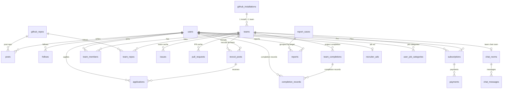

## 3. ERD by domain

### 3-1. Account & profile

```mermaid
erDiagram
  users ||--o{ auth_identities : "login methods"
  users ||--o| github_tokens : "GitHub token"
  users ||--o{ user_sessions : "login sessions"
  users ||--o{ user_agreements : "consents"
  users ||--o{ user_tech_tags : "tech stack"
  tech_tags ||--o{ user_tech_tags : "tag"
  users ||--o{ username_redirects : "old usernames"
  users ||--o{ contribution_days : "contribution graph"
  users ||--o| recruiter_profiles : "recruiter info"
  users |o--o{ email_verifications : "password reset"

  users {
    bigint id PK
    varchar username UK "GitHub login, profile URL"
    varchar display_name "1-20 chars"
    varchar avatar_url
    varchar bio "160 chars"
    varchar blog_url "one https URL"
    varchar email "for notifications, private"
    timestamptz email_verified_at
    varchar user_type "DEVELOPER, RECRUITER, immutable after sign-up"
    varchar status "ACTIVE, SUSPENDED, WITHDRAWING, DELETED"
    timestamptz suspended_until "null = permanent or n/a"
    boolean looking_for_team "looking for team"
    varchar job_seeking_status "OPEN, OFFERS_ONLY, OFF (default)"
    timestamptz job_seeking_updated_at
    boolean push_enabled "push on/off (off stops push only)"
    timestamptz contribution_synced_at "last graph refresh"
    timestamptz last_active_at
    timestamptz withdraw_requested_at "withdrawal pending start"
    timestamptz deleted_at "anonymized"
    timestamptz onboarded_at "profile step finished, session onb"
  }
  auth_identities {
    bigint id PK
    bigint user_id FK
    varchar provider "GITHUB, EMAIL (recruiter)"
    varchar provider_user_id "GitHub user id, UK with provider"
    varchar provider_login "GitHub login"
    varchar email
    varchar password_hash "EMAIL only, bcrypt"
    int failed_login_count "lock at 5"
    timestamptz locked_until "10 min"
    timestamptz last_login_at
  }
  github_tokens {
    bigint id PK
    bigint user_id FK "UK"
    text access_token_enc "AES encrypted"
    timestamptz access_expires_at "8 hours"
    text refresh_token_enc
    timestamptz refresh_expires_at "6 months"
  }
  user_sessions {
    bigint id PK
    bigint user_id FK
    varchar refresh_token_hash UK
    varchar user_agent
    varchar ip
    timestamptz expires_at "30 days, extended on use"
    timestamptz otp_verified_at "operator 2FA"
    timestamptz operator_seen_at "last operator request; idle 30 min revokes the session"
    timestamptz revoked_at
  }
  user_agreements {
    bigint id PK
    bigint user_id FK
    varchar agreement_type "TERMS, PRIVACY, AGE_14, MARKETING"
    varchar version "terms version"
    timestamptz agreed_at
    timestamptz withdrawn_at "marketing withdrawn"
  }
  tech_tags {
    bigint id PK
    varchar name UK "React, Spring ..."
    varchar category "LANGUAGE, FRONTEND, BACKEND, INFRA, ..."
    int sort_order
  }
  user_tech_tags {
    bigint id PK
    bigint user_id FK
    bigint tag_id FK
  }
  username_redirects {
    bigint id PK
    varchar old_username UK
    bigint user_id FK
    timestamptz expires_at "90 days"
  }
  contribution_days {
    bigint id PK
    bigint user_id FK
    date day "UK with user_id"
    int contribution_count
  }
  recruiter_profiles {
    bigint id PK
    bigint user_id FK "UK"
    varchar company_name "2-40 chars"
    varchar company_email_domain "verified email domain"
    varchar job_title "1-30 chars"
    varchar company_url "https, optional"
    timestamptz email_verified_at "company email verified"
  }
  email_verifications {
    bigint id PK
    varchar email
    varchar purpose "SIGNUP, PASSWORD_RESET"
    bigint user_id FK "for PASSWORD_RESET"
    varchar code_hash "hash of code / link token"
    int attempt_count "invalid at 5"
    timestamptz expires_at "code 10 min, link 30 min"
    timestamptz used_at
  }
```

### 3-2. Posts & social

```mermaid
erDiagram
  users ||--o{ posts : "writes"
  github_repos ||--o{ posts : "repo card"
  teams |o--o{ posts : "team project (optional)"
  posts ||--o{ post_images : "photos"
  uploaded_files ||--o| post_images : "file"
  posts ||--o{ post_demo_links : "demo links"
  posts ||--o{ post_tags : "tags"
  tech_tags ||--o{ post_tags : "tag"
  posts ||--o{ post_likes : "likes"
  users ||--o{ post_likes : "likes"
  posts ||--o{ comments : "comments"
  users ||--o{ comments : "writes"
  comments |o--o{ comments : "one-level replies"
  users ||--o{ follows : "follower"
  users ||--o{ follows : "following"
  users ||--o{ pinned_posts : "pins"
  posts ||--o{ pinned_posts : "pinned"
  users ||--o{ feed_seen_posts : "seen"
  users ||--o{ profile_visits : "viewed by recruiters"
  posts ||--o{ post_views : "views"
  users ||--o{ uploaded_files : "uploads"

  uploaded_files {
    bigint id PK
    bigint uploader_id FK
    varchar purpose "POST, CHAT, ISSUE, AVATAR"
    varchar storage_key UK
    varchar url
    varchar content_type
    bigint byte_size
    int width
    int height
    timestamptz original_deleted_at "chat image original deleted (free team 90 days, Flex kept, 1:1 chat 1 year)"
  }
  posts {
    bigint id PK
    bigint author_id FK
    bigint repo_id FK "UK with author_id"
    bigint team_id FK "nullable"
    varchar summary "one-line intro 1-60 chars, required"
    text body "2,000 chars"
    varchar my_role "40 chars"
    text problem_solution "problem & solution"
    date period_start "month precision"
    date period_end
    int team_size "1-50"
    int my_commit_count "GitHub cache"
    int linker_issue_count "issues handled in Linker"
    int like_count "denormalized counter"
    int comment_count
    int view_count "view count, total shown to free users too"
    varchar visibility "VISIBLE, UNDER_REVIEW, HIDDEN"
    timestamptz edited_at "edited marker"
    timestamptz deleted_at
  }
  post_images {
    bigint id PK
    bigint post_id FK
    bigint file_id FK
    int sort_order "0 = cover"
  }
  post_demo_links {
    bigint id PK
    bigint post_id FK
    varchar url "https, max 3"
    int sort_order
  }
  post_tags {
    bigint id PK
    bigint post_id FK
    bigint tag_id FK
  }
  post_likes {
    bigint id PK
    bigint post_id FK
    bigint user_id FK "UK with post_id"
  }
  comments {
    bigint id PK
    bigint post_id FK
    bigint author_id FK
    bigint parent_id FK "nullable, reply"
    varchar body "500 chars"
    varchar visibility
    timestamptz edited_at
    timestamptz deleted_at
  }
  follows {
    bigint id PK
    bigint follower_id FK
    bigint following_id FK "UK with follower_id"
  }
  pinned_posts {
    bigint id PK
    bigint user_id FK
    bigint post_id FK "UK with user_id"
    int sort_order
  }
  feed_seen_posts {
    bigint id PK
    bigint user_id FK
    bigint post_id FK "UK with user_id"
    timestamptz seen_at
  }
  profile_visits {
    bigint id PK
    bigint profile_user_id FK
    bigint visitor_id FK "recruiters only"
    date visit_date "3-column UK, once per day"
  }
  post_views {
    bigint id PK
    bigint post_id FK
    bigint viewer_id FK
    date view_date "3-column UK"
    varchar source "FEED, PROFILE, RECRUIT_POST, CHAT_SHARE, EXTERNAL, SEARCH (phase 2)"
    boolean readme_expanded
  }
```

### 3-3. Find Team

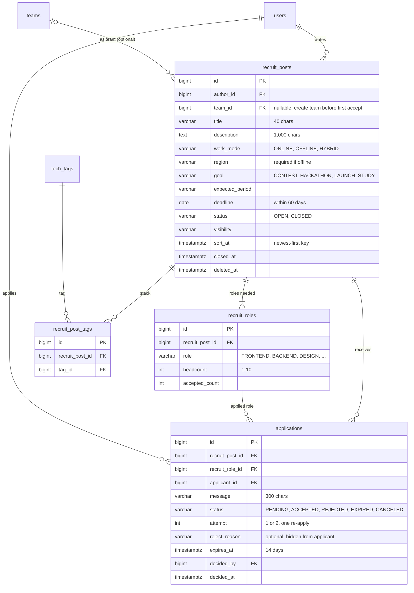

### 3-4. Teams & GitHub integration

```mermaid
erDiagram
  github_installations ||--o| teams : "org install"
  users ||--o{ github_installations : "installer"
  teams ||--o{ team_members : "members"
  users ||--o{ team_members : "belongs"
  teams ||--o{ team_repos : "linked repos"
  github_repos ||--o{ team_repos : "linked"
  teams ||--o{ team_invite_links : "invite links"
  teams ||--o{ github_org_invitations : "org invites"
  users ||--o{ github_org_invitations : "invited"
  teams ||--o{ team_ownership_transfers : "owner transfer"
  teams ||--o| team_project_boards : "one board"
  team_project_boards ||--o{ board_status_mappings : "status mapping"
  teams ||--o{ team_completions : "project completion"
  team_completions ||--o{ completion_records : "per-member record"
  users ||--o{ completion_records : "completion records"
  github_installations ||--o{ github_webhook_deliveries : "webhooks"

  github_installations {
    bigint id PK
    bigint github_installation_id UK
    bigint account_id "GitHub org id"
    varchar account_login
    varchar account_type "Organization"
    varchar repository_selection "ALL, SELECTED"
    bigint installed_by FK
    timestamptz suspended_at
    timestamptz removed_at "app uninstalled webhook"
  }
  github_repos {
    bigint id PK
    bigint github_repo_id UK "survives renames"
    varchar owner_login
    varchar name
    varchar full_name
    varchar description
    varchar primary_language
    int stargazers_count
    varchar html_url
    boolean is_private
    boolean is_fork
    varchar parent_full_name "fork source"
    varchar default_branch
    timestamptz metadata_synced_at "once a day"
    timestamptz deleted_at "repo no longer visible"
  }
  github_webhook_deliveries {
    bigint id PK
    varchar delivery_id UK "X-GitHub-Delivery, dedupe"
    varchar event "issues, pull_request, projects_v2_item, organization, installation"
    varchar action
    bigint installation_id FK
    jsonb payload
    varchar status "RECEIVED, PROCESSED, FAILED, IGNORED"
    int attempts
    text error
    timestamptz processed_at
  }
  teams {
    bigint id PK
    bigint installation_id FK
    bigint github_org_id UK "1 org = 1 team"
    varchar github_org_login
    varchar name
    varchar description
    varchar avatar_url
    varchar status "ACTIVE, COMPLETED, READ_ONLY, ARCHIVED, DELETED"
    varchar org_base_permission "read, write, ..."
    bigint created_by FK
    timestamptz read_only_since "app removed, archived after 30 days"
    timestamptz archived_at
    timestamptz delete_scheduled_at "chat deleted too after 30 days"
    boolean ai_summary_enabled "owner can turn AI summary off"
  }
  team_members {
    bigint id PK
    bigint team_id FK
    bigint user_id FK
    varchar role "OWNER, ADMIN, MEMBER"
    varchar github_org_state "NOT_MEMBER, INVITED, MEMBER"
    timestamptz joined_at
    timestamptz left_at "null = current member"
    varchar leave_type "LEFT, KICKED, ORG_REMOVED, TEAM_DELETED"
  }
  team_repos {
    bigint id PK
    bigint team_id FK
    bigint repo_id FK "UK with team_id"
    bigint connected_by FK
  }
  team_invite_links {
    bigint id PK
    bigint team_id FK
    varchar token_hash UK
    bigint created_by FK
    timestamptz expires_at "7 days"
    timestamptz revoked_at
  }
  github_org_invitations {
    bigint id PK
    bigint team_id FK
    bigint inviter_id FK "org owner only"
    bigint invitee_user_id FK
    varchar invitee_login
    bigint github_invitation_id
    varchar status "PENDING, ACCEPTED, FAILED, EXPIRED"
    timestamptz reminded_at "reminder after 7 days unaccepted"
  }
  team_ownership_transfers {
    bigint id PK
    bigint team_id FK
    bigint from_user_id FK
    bigint to_user_id FK
    varchar status "PENDING, ACCEPTED, DECLINED, CANCELED"
    timestamptz responded_at
  }
  team_project_boards {
    bigint id PK
    bigint team_id FK "UK, one per team"
    varchar github_project_node_id
    int project_number
    varchar title
    boolean created_by_linker "auto-created board"
    varchar status_field_id
    varchar start_date_field_id
    varchar due_date_field_id
    bigint connected_by FK
  }
  board_status_mappings {
    bigint id PK
    bigint board_id FK
    varchar github_option_id "UK with board_id"
    varchar github_option_name
    varchar linker_status "TODO, IN_PROGRESS, BLOCKED, DONE, OTHER"
  }
  team_completions {
    bigint id PK
    bigint team_id FK
    bigint completed_by FK
    timestamptz completed_at
    timestamptz revertible_until "7 days"
    timestamptz confirmed_at "confirmed, completion records written"
    timestamptz reverted_at
  }
  completion_records {
    bigint id PK
    bigint completion_id FK
    bigint user_id FK
    varchar result "COMPLETED, DROPPED"
    int assigned_issue_count
    int done_issue_count
  }
```

### 3-5. Issues & PRs

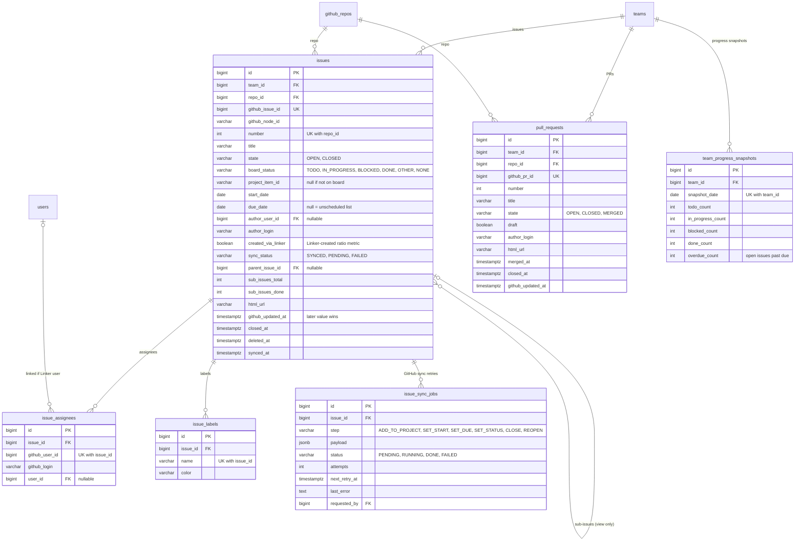

### 3-6. Chat

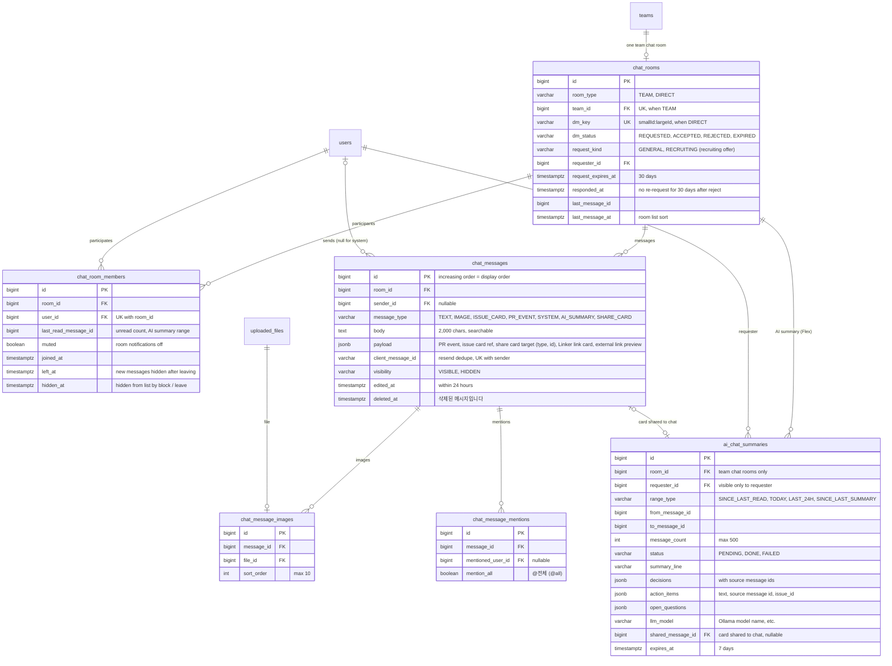

### 3-7. Notifications

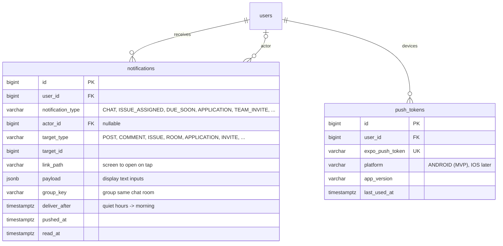

### 3-8. Reports, blocking, operations

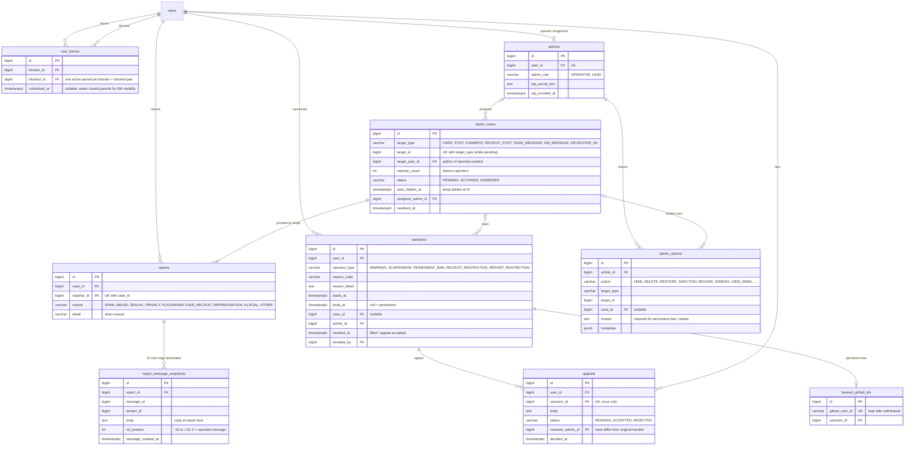

### 3-9. Subscription & payment

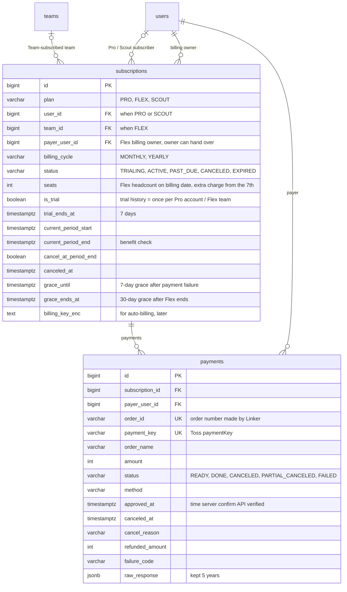

### 3-10. Job ads

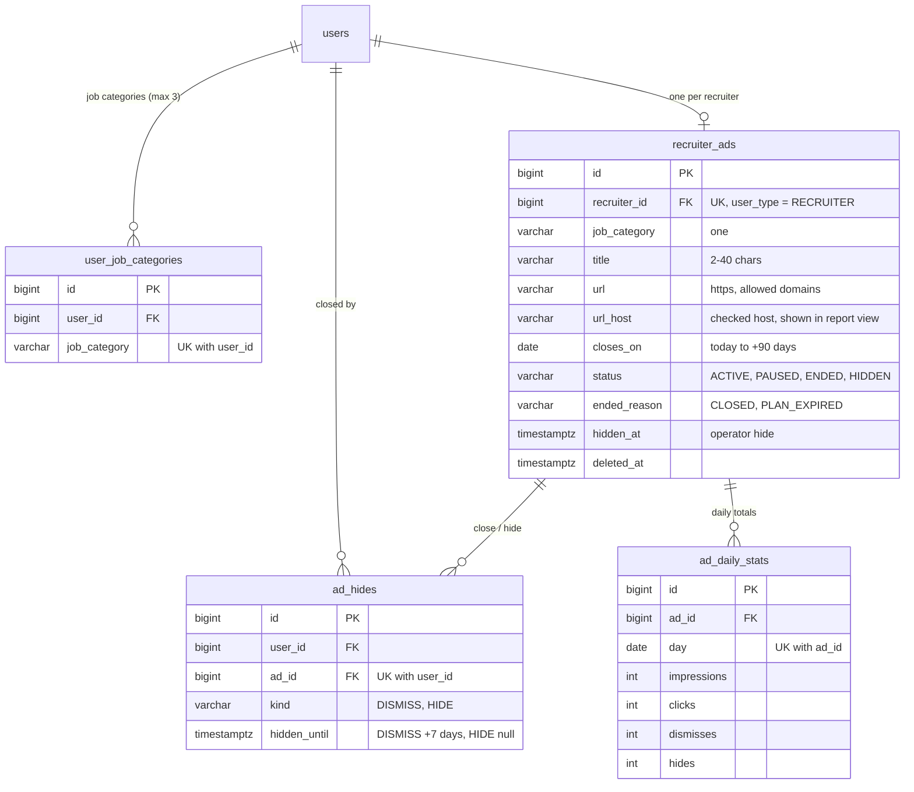

## 4. Table notes

`id`, `created_at`, `updated_at` exist on every table and are omitted. Columns already explained by the one-line note in the diagram are skipped; only columns and constraints that are easy to get wrong are listed.

### 4-1. Account & profile

| Table | Scope | Purpose | Basis |
| --- | --- | --- | --- |
| users | 🟢 | Linker member, separate from login method | A-1, A-2, A-3, POL ch. 2 user states |
| auth_identities | 🟢 | Login methods (GitHub for developers, email for recruiters) | PRD 5-1 account structure |
| github_tokens | 🟢 | GitHub user token for actions in the user's name (create issues, org invites) | PRD ch. 8, non-functional security |
| user_sessions | 🟢 | Refresh token and 30-day login, operator OTP status | POL-A-1, POL ch. 10 |
| user_agreements | 🟢 | Consent history: terms, privacy, age 14+, marketing | POL-A-1, Privacy Policy |
| tech_tags | 🟢 | Predefined tech stack tag list (seed data) | POL-A-3 |
| user_tech_tags | 🟢 | My tech stack, max 10, unique (user_id, tag_id) | A-3 |
| username_redirects | 🟡 | 90-day redirect of old URL after GitHub username change | POL ch. 3 exceptions |
| contribution_days | 🟡 | Daily GitHub contributions, last 12 months, refreshed daily | A-4 |
| recruiter_profiles | 🟡 | Recruiter company name, job title, verified email domain (1:1 with users) | H-1, POL ch. 3 recruiter accounts |
| email_verifications | 🟡 | Recruiter sign-up codes, password reset links | H-1 |

**users**

| Column | Notes |
| --- | --- |
| username | GitHub login as-is. User can't change it; refreshed from GitHub on next login. When it changes, the old value goes into `username_redirects` |
| email | GitHub public email or a notification email collected at sign-up. Not shown on profile. Masked in back office |
| status | ACTIVE → SUSPENDED (back to ACTIVE when the period ends) / WITHDRAWING (back to ACTIVE if they log in within 30 days) → DELETED |
| suspended_until | Cache for quickly checking the current suspension end. Source of truth is `sanctions` |
| looking_for_team | When on, shown in Find Team search. Batch turns it off after 30 days inactive (based on `last_active_at`) |
| user_type | DEVELOPER (GitHub sign-up) / RECRUITER (company email sign-up). Set at sign-up, never changes. RECRUITER gets an auto-generated `username` of `r-` + number, and GitHub columns/tables stay empty |
| job_seeking_status | Job-seeking status (POL-H-4). OPEN = job seeking (badge for everyone), OFFERS_ONLY = offers only (shown to recruiters only), OFF = recruiting offers blocked. DEVELOPER only. Batch sets OFF after 90 days inactive |
| deleted_at | 30 days after withdrawal, personal columns (name, avatar, bio, email) are cleared and this is set |
| onboarded_at | Set when onboarding profile save finishes. Null until then. The session `onb` claim follows this column |

- Indexes: `username` UK, `status`, `looking_for_team` + `last_active_at`, `job_seeking_status` (recruiter feed filter).
- Recruiters are not split into a separate table; they live in `users`. Chat, reports, blocking, sanctions and notifications all point at `users.id`, so everything is reused as-is.
- Completion record (A-5) is aggregated from `completion_records`. If profile reads get heavy, add cache columns `completed_count`, `dropped_count`, `issue_done_rate` to `users`.

**auth_identities**

| Column | Notes |
| --- | --- |
| provider + provider_user_id | UK. GitHub accounts are found by the immutable numeric id (login survives username changes) |
| provider = EMAIL | Recruiters. `provider_user_id` holds the lowercased email, so the UK blocks duplicate sign-ups |
| password_hash | Recruiters only (bcrypt). null for GITHUB rows |
| failed_login_count, locked_until | After 5 failures, `locked_until = now + 10 min`; reset to 0 on success |

**github_tokens**: `user_id` UK (1:1). Tokens are stored AES-encrypted and never sent to the app or frontend. When expired, the server refreshes with the refresh token; if that fails, it asks the user to log in again.

**user_sessions**: Only the refresh token hash is stored, and a new one is issued on every use (rotation). `revoked_at` is set on logout, withdrawal and suspension. `otp_verified_at` is when the operator passed 2FA to enter the back office. `operator_seen_at` is the last authenticated operator request; 30 minutes without one revokes the session. OTP enrollment is still a later step, so an `admins` row is enough to open the back office until then.

**recruiter_profiles**: `user_id` UK (1:1). `company_email_domain` is used for the profile's "회사 메일 인증(@domain)" (Company email verified) label and for operator checks. When operator company verification is added in phase 3, create a `companies` table and add `company_id`.

**email_verifications**: Before sign-up there is no member, so SIGNUP is looked up by `email` only; once the code is confirmed, `users`, `auth_identities` and `recruiter_profiles` are created in the same transaction. Raw codes/tokens are never stored, only hashes. Sending a new code sets `used_at` on earlier rows with the same email and purpose to invalidate them. The 1-per-minute resend limit is a Redis counter.

**contribution_days**: `user_id + day` UK. Overwritten once a day from the GraphQL `contributionCalendar` response. If loading fails, `users.contribution_synced_at` is used to show "as of N days ago".

### 4-2. Posts & social

| Table | Scope | Purpose | Basis |
| --- | --- | --- | --- |
| uploaded_files | 🟢 | Uploaded image metadata (posts, chat, issue bodies, avatars) | Policy ch. 2 images |
| posts | 🟢 | Repo-based project posts | P-1, P-2 |
| post_images | 🟢 | Post photos, first is cover | P-2, free 5 / Pro 10 |
| post_demo_links | 🟢 | Demo links, max 3 | POL-P-2 |
| post_tags | 🟢 | Post tags, max 5 | POL-P-2 |
| post_likes | 🟢 | Likes, once per post | P-5 |
| comments | 🟢 | Comments and one-level replies | P-5 |
| follows | 🟢 | Follows, mutual follow and 2nd-degree calculation | P-5, P-4 |
| feed_seen_posts | 🟢 | Record to exclude already-seen posts from recommendations | POL-P-4 |
| pinned_posts | 🟡 | Pinned featured posts, free 1 / Pro 5 | A-6 |
| profile_visits | 🟡 | Recruiter profile views, once per recruiter per day, kept 90 days | S-10 |
| post_views | 🟡 | Post views, traffic source, README expand count | S-4, P-7 |

**posts**

| Column | Notes |
| --- | --- |
| author_id + repo_id | UK. One post per person per repo. Several team members may post the same repo |
| repo_id | References `github_repos`. Repo name, language and stars are not copied into posts; read from `github_repos` |
| team_id | Set when coming in from the "post your project" prompt after project completion (T-4). Used to compute `linker_issue_count` |
| my_commit_count | My commit count for this repo, fetched from GitHub at write time and daily. 0 is never used as grounds for sanctions |
| like_count, comment_count | Counters for feed sort/display. Incremented/decremented in the like/comment transaction |
| visibility | UNDER_REVIEW / HIDDEN by 5 reporters or operator action. Author sees "검토 중" (Under review) |

- Indexes: `(author_id, created_at desc)`, `(created_at desc)` for the feed, `repo_id` ("other posts for this repo").
- Deleting a post soft-deletes its likes and comments too.

**comments**: `parent_id` may only point to a top-level comment (one-level replies, validated in the service layer). Deleting a comment that has replies keeps the row and shows "삭제된 댓글입니다" (Deleted comment).

**follows**: `follower_id + following_id` UK. Mutual follow = the reverse row exists. Blocking deletes rows in both directions.

**feed_seen_posts**: Records recommended posts that appeared on screen in the feed. Grows fast, so rows older than 30 days are deleted by batch. Can move to a Redis Set if it gets heavy.

**profile_visits, post_views**: Self-visits and guest visits are not recorded. `profile_visits` is written only when a `user_type = RECRUITER` member views a developer profile; Pro screens and the weekly notice show only the weekly **count** (never who or which company). Rows older than 90 days are deleted. `post_views.source` is feed (FEED), profile (PROFILE), recruit post (RECRUIT_POST), chat share card or Linker link card (CHAT_SHARE), and copied links with `?from=share` or other external traffic (EXTERNAL). Free shows only total views; Pro aggregates by traffic source and date.

### 4-3. Find Team

| Table | Scope | Purpose | Basis |
| --- | --- | --- | --- |
| recruit_posts | 🟢 | Recruit posts | R-1, R-2, S-5 |
| recruit_roles | 🟢 | Headcount per role for a recruit post | R-1, POL-R-1 |
| recruit_post_tags | 🟢 | Tech stack filter for recruit posts | R-2 |
| applications | 🟢 | Applications and their status | R-3, R-4 |

**recruit_posts**

| Column | Notes |
| --- | --- |
| team_id | Nullable because a post can be written without a team. Set once team creation is done before the first acceptance |
| status | OPEN ↔ CLOSED. Becomes CLOSED (batch or transaction) when the deadline passes or every role's `accepted_count` reaches `headcount` |
| sort_at | Sort key for the newest list. `created_at` on write (bump was dropped in the 2026-10-30 subscription revamp; kept so it can return without a migration) |

- Concurrent post limit (free 3, Pro 10) is checked by counting OPEN posts for `author_id`.
- Indexes: `(status, sort_at desc)`, `(status, deadline)`, `work_mode`.

**applications**

| Column | Notes |
| --- | --- |
| status | PENDING → ACCEPTED / REJECTED / EXPIRED (14 days, recruit post deleted) / CANCELED (only while PENDING) |
| attempt | Re-applying to the same post after cancel is allowed once, so max 2 |
| reject_reason | Author's note. The applicant only gets a fixed message |

- Indexes: `(recruit_post_id, status)`, `(applicant_id, created_at desc)`, `expires_at` (expiry batch).
- Accepting does, in one transaction: increment `recruit_roles.accepted_count`, add `team_members`, add team `chat_room_members`, create notification.

### 4-4. Teams & GitHub integration

| Table | Scope | Purpose | Basis |
| --- | --- | --- | --- |
| github_installations | 🟢 | Linker GitHub App installed on an org | T-1, PRD ch. 8 |
| github_repos | 🟢 | GitHub repo metadata cache (shared by posts, team links, issues) | P-1, T-3 |
| github_webhook_deliveries | 🟢 | Raw received webhooks, dedupe and reprocessing | MVP launch condition (missed webhooks) |
| teams | 🟢 | Linker team = one GitHub org | T-1, POL ch. 6 team states |
| team_members | 🟢 | Team members, roles, join/leave history | T-2, POL ch. 6 permissions |
| team_repos | 🟢 | Repos linked to the team | T-3 |
| team_invite_links | 🟢 | Linker invite links, valid 7 days | T-2 |
| github_org_invitations | 🟢 | GitHub org invitation send log | T-2, R-4 |
| team_project_boards | 🟢 | GitHub Projects board linked to the team, one per team | I-3, POL ch. 7 Projects setup |
| board_status_mappings | 🟢 | Board Status options ↔ Linker's 4 states | I-4 |
| team_completions | 🟢 | Project completion and 7-day revert | T-4 |
| completion_records | 🟢 | Per-member completed/dropped and issue completion rate | A-5, POL-T-4 |
| team_ownership_transfers | 🟢 | Owner transfer request and acceptance | POL ch. 6 exceptions |

**github_installations**: The `installation_id` returned to Linker after install can be forged, so a row is created only after the server confirms it by calling `GET /user/installations` with the user token. `suspended_at` and `removed_at` are updated from the `installation` webhook.

**github_webhook_deliveries**: `delivery_id` UK prevents processing the same webhook twice. Stored and acknowledged immediately on receipt, then processed asynchronously (@Async / Redis queue). Processed rows are deleted after 30 days.

Current foundation implementation: V1 has no installation FK and stores the external GitHub installation ID from the payload. Page 08 must resolve it through `github_installations.github_installation_id` before wiring the planned relation; do not treat it as an internal PK. The dispatcher uses the existing status/attempts/error fields, short outcome transactions and a session advisory lock (no DB transaction during handler HTTP calls). Stale RECEIVED/FAILED rows are requeued with operational retry settings. Queue delivery is at least once; domain handlers remain idempotent. No new table/column/enum is introduced by this foundation work. See [GitHub App operations](../operations/06-github-app.md).

**teams**

| Column | Notes |
| --- | --- |
| github_org_id | UK. 1 org = 1 team. Follows the org even if renamed |
| status | ACTIVE ↔ COMPLETED, ACTIVE → READ_ONLY (app removed) → ARCHIVED (30 days), → DELETED (chat deleted too after 30 days) |
| org_base_permission | Org base repo permission checked at team creation. If read, the owner is told to grant write |

- Team size limit (free 6, Flex no limit) is checked by current member count in `team_members` and whether there's an active Flex subscription.
- One person can be in at most 10 teams (archived excluded).

**team_members**

| Column | Notes |
| --- | --- |
| left_at | null = current member. Rows aren't deleted on leave; used for completed/dropped calculation and "나간 멤버" (Former member) display |
| leave_type | KICKED blocks applying to the same team's recruit posts for 7 days. ORG_REMOVED comes from the `organization` webhook (member_removed) |
| github_org_state | Before accepting the org invite (INVITED), excluded from issue assignee candidates |

- Constraint: partial unique index `(team_id, user_id) WHERE left_at IS NULL`. One OWNER per team (service-layer check).

**team_project_boards, board_status_mappings**: If there's no board, Linker creates a "Linker" board with `created_by_linker = true` and auto-inserts 4 mappings: Todo, In Progress, Blocked, Done. If an existing board is chosen, the user sets the mapping and unmapped options become OTHER. Changing boards creates a new row and re-syncs `project_item_id` for the team's issues.

**team_completions, completion_records**: Completing creates a `team_completions` row, revertible for 7 days. After 7 days a batch sets `confirmed_at` and creates per-member `completion_records`. Members at completion time with 14+ days of membership are COMPLETED; those who left during the period are DROPPED. Issue completion rate = `done_issue_count / assigned_issue_count`.

### 4-5. Issues & PRs

| Table | Scope | Purpose | Basis |
| --- | --- | --- | --- |
| issues | 🟢 | GitHub issues + Projects date/status cache | I-1~I-5 |
| issue_assignees | 🟢 | Assignees, max 10 | I-2, I-5 |
| issue_labels | 🟢 | Labels | I-2 |
| issue_sync_jobs | 🟢 | Per-step retries after issue creation: add to project, dates, status | POL ch. 7 sync |
| pull_requests | 🟢 | PR cache, team chat PR list tab | C-3 |
| team_progress_snapshots | 🟡 | Daily per-team status counts for the project progress graph (last 14 days trend) | T-7, S-9, POL-T-7 |

**issues**

| Column | Notes |
| --- | --- |
| state, board_status | `state` is the GitHub issue open/closed; `board_status` is Projects Status converted via `board_status_mappings`. A closed issue counts as DONE; BLOCKED stays open |
| start_date, due_date | Projects field values. If `due_date` is null, the issue goes to the "일정 없음" (Unscheduled) list instead of the calendar |
| sync_status | PENDING while a change made in Linker is being applied to GitHub; FAILED if retries are exhausted ("일정이 GitHub에 반영되지 않았어요" — schedule not applied to GitHub) |
| github_updated_at | On concurrent edits the later value wins. Ignore a webhook whose `updated_at` is older than this |
| parent_issue_id, sub_issues_* | MVP only views sub-issues created on GitHub and shows "3개 중 1개 완료" (1 of 3 done) |
| deleted_at | Set when deleted on GitHub. Issue cards in chat show "삭제된 이슈" (Deleted issue) |

- Indexes: `(team_id, due_date)` calendar, `(team_id, board_status)` status board, `(repo_id, number)` UK.
- "My issues" (I-5) = `issue_assignees.user_id = me` + selected `team_id` + `due_date` ascending. Default team = my `team_members` row with the latest `joined_at` (prefer non-archived).

**issue_assignees**: Stores GitHub assignees as-is and links `user_id` if that GitHub user is a Linker member. If an assignee leaves the team, the row stays and the UI shows "팀 밖 사용자" (Outside the team).

**issue_sync_jobs**: Creating one issue needs 3–5 GitHub calls. Once the issue itself is created, the remaining steps are queued as rows and a scheduler processes them by `next_retry_at`. Steps that don't need the user's identity use the installation token.

**team_progress_snapshots**: Columns are `team_id`, `snapshot_date` (UK together), `todo_count`, `in_progress_count`, `blocked_count`, `done_count`, `overdue_count`. A batch at 00:00 KST counts `issues.board_status` (excluding OTHER and NONE) per team. Stored for every team regardless of Flex; only the screen is Flex-only. Today's value isn't stored; it's counted from `issues` when the screen opens. Issue status change history is not stored, so metrics like cycle time (days spent In Progress) belong to the phase 2 bottleneck dashboard (T-6) with its own event table. Rows older than 1 year are deleted.

**pull_requests**: Updated from the `pull_request` webhook. Opened, review requested, merged and closed events create a `message_type = PR_EVENT` message in the team chat room, with PR info in `payload`.

### 4-6. Chat

| Table | Scope | Purpose | Basis |
| --- | --- | --- | --- |
| chat_rooms | 🟢 | Team chat rooms and 1:1 chat rooms (same structure) | C-1, C-4, PRD risk "both chats share one storage model" |
| chat_room_members | 🟢 | Participants, last read position, mute | C-1 read receipts |
| chat_messages | 🟢 | Messages (text, images, issue cards, PR system messages) | C-1~C-4, S-6 |
| chat_message_images | 🟢 | Message images, max 10 at once | C-1 |
| chat_message_mentions | 🟢 | @person, @all mention notifications | POL ch. 8 mentions |
| ai_chat_summaries | 🟡 | AI chat summary (minutes format) for Flex teams, kept 7 days | C-5, S-8, POL-C-5 |

**chat_rooms**

| Column | Notes |
| --- | --- |
| room_type | TEAM uses `team_id` (UK), DIRECT uses `dm_key` (UK) |
| dm_key | The two user ids joined as small:large. Ensures only one room per pair |
| dm_status | ACCEPTED from the start for mutual follows or teammates. Otherwise REQUESTED (first message only) → ACCEPTED / REJECTED / EXPIRED (30 days) |
| last_message_id, last_message_at | Denormalized latest message. Page 16 list still computes the viewer-visible message. Text send writes the pointer only after checking the message is in that room. `team_id` has no FK until `teams` exists (page 08). V3 adds `client_message_id` (unique with `sender_id`). `payload` and `edited_at` stay deferred until image or edit writes need them |
| request_kind | Drives the "채용 제안" (Recruiting offer) label in the request inbox. RECRUITING for rooms created by recruiters, otherwise GENERAL. Kept after acceptance for stats (offer acceptance rate) and the recruiter my page "보낸 채용 제안" (Sent offers) list. List status maps dm_status for display: ACCEPTED → 대화 중 (In conversation), REQUESTED / REJECTED (within 30 days) → 응답 대기 (Awaiting reply), EXPIRED / REJECTED (after 30 days) → 응답 없음 (No reply). Index `(requester_id, request_kind, created_at desc)`. 10/day (Scout 50) limit in Redis |

**chat_room_members**: Unread count = messages in the room with `id > last_read_message_id`. Team chat "unread by N people" = number of members whose `last_read_message_id` is less than the message id. Leaving the team sets `left_at`, and later messages are not visible.

**chat_messages**

| Column | Notes |
| --- | --- |
| id | Order the server received. Basis for display order and "load after the last received message" |
| sender_id | null for system and PR messages |
| client_message_id | UUID generated by the frontend. No duplicate save on resend (UK with `sender_id`) |
| body | Team chat search target. `pg_trgm` GIN index for Korean partial-match search. Free teams can only search and view the last 60 days (older messages aren't deleted, the API filters them; 30-day grace after Flex ends) |
| message_type = SHARE_CARD | Card created by "채팅방에 공유" (Share to chat room) in the share sheet. `payload` holds only `{targetType: POST / RECRUIT_POST / PROFILE, targetId}`; content isn't copied. When shown, the original is read; deleted, hidden or blocked → "볼 수 없는 게시물이에요". A TEXT message containing a Linker URL stores the same structure in `payload.linkerCard` |
| visibility | HIDDEN when hidden by report ("운영 정책에 따라 숨겨진 메시지예요" — hidden under the operating policy) |

- Indexes: `(room_id, id desc)` infinite scroll, `body` GIN (trgm).
- 1:1 messages from a blocked user are stored but not delivered to or readable by the recipient. Filter messages whose `sender_id` is the blocked user and whose `created_at` falls in any recipient-owned `user_blocks` period: `[created_at, unblocked_at)` (an open period has no end). Apply the same filter to history, reconnect catch-up, previews, unread counts, search and notifications. Closed periods still apply after unblocking (POL ch. 9); team chat is exempt.

**ai_chat_summaries**: Created only in chat rooms of teams with an active Flex subscription (including the 7-day free trial) and `teams.ai_summary_enabled` (server check). 10 per person per day is a Redis counter. Pressing "채팅에 공유" (Share to chat) creates a `message_type = AI_SUMMARY` message, copies the summary into its payload and stores it in `shared_message_id`. So the shared card stays in team chat even after the summary row is deleted after 7 days. Creating an issue from an action item fills `issue_id` in `action_items`.

### 4-7. Notifications

| Table | Scope | Purpose | Basis |
| --- | --- | --- | --- |
| notifications | 🟢 | In-app notification list and push send log | N-1 |
| push_tokens | 🟢 | Expo push tokens, multiple devices per person | N-1 |

**notifications**: Every feature only calls `NotificationService.create()`; sending is handled by a queue. Non-chat notifications between 10 PM and 8 AM get `deliver_after` set to 8 AM and are sent in a batch. Notifications from the same chat room are grouped by `group_key`. Due-tomorrow notifications are created by a daily 9 AM batch from `issues.due_date`.

**push_tokens**: `expo_push_token` UK. Deleted when Expo reports the token as invalid.

### 4-8. Reports, blocking, operations

| Table | Scope | Purpose | Basis |
| --- | --- | --- | --- |
| user_blocks | 🟢 | Active and closed blocking periods (`created_at`, `unblocked_at`) | POL ch. 9 blocking; 00 creates/closes periods, 06 lists active blocks, 16–17 filter DM visibility |
| report_cases | 🟢 | Reports grouped by target, the unit operators handle | O-1 |
| reports | 🟢 | One report (per reporter) | O-1, POL ch. 9 reports |
| sanctions | 🟢 | Warning, suspension, permanent ban, feature restrictions | O-3, POL ch. 9 sanction steps |
| admins | 🟢 | Operator assignment (DB seed), OTP | POL ch. 10 |
| admin_actions | 🟢 | Log of every operator action (append-only, no update/delete) | O-5 |
| report_message_snapshots | 🟢 | Copy of 10 messages before/after a reported chat message | O-4 |
| appeals | 🟢 | One appeal | POL ch. 9 appeals |
| banned_github_ids | 🟢 | Blocks re-sign-up of permanently banned GitHub accounts | POL ch. 9 re-sign-up |

**user_blocks**: `created_at` is the start of each blocking period; nullable `unblocked_at` is its end. Replace the pair-wide unique constraint with a partial unique index `(blocker_id, blocked_id) WHERE unblocked_at IS NULL`. Blocking an already-active pair is idempotent. Unblocking sets `unblocked_at` instead of deleting the row; blocking again inserts a new period, preserving all previous intervals. Lists and current access checks use only active periods; DM visibility checks use both active and closed periods. Index `(blocker_id, blocked_id, created_at)` for interval lookup and CHECK `unblocked_at IS NULL OR unblocked_at >= created_at`. Serialize block/unblock and message-visibility decisions for the same pair to avoid races. Preserve history while related DM messages remain, subject to the account/data-deletion policy; unblocking alone must not purge it. New `user_blocks` periods take `created_at` and `unblocked_at` from the application clock truncated to microseconds, the same authority as a chat text `created_at`. PostgreSQL `now()` is not the period start. Global JPA auditing is unchanged. The blocking-period change introduces no tables, enums or endpoints. Current WBS totals are 69 tables / 18 system HTTP controllers / 205 REST endpoints; controller consolidation does not change this data model.

**report_cases, reports**: A new report attaches to the pending case with the same `target_type + target_id`, or creates one. `reports` UK `case_id + reporter_id` counts duplicate reports from one person as one. When distinct reporters reach 5, `auto_hidden_at` is set and the target content's `visibility` becomes UNDER_REVIEW. Reports from users restricted for false reporting are not counted in `reporter_count`.

**sanctions**: The current step is computed from unrevoked sanctions in the last year. Creating a suspension also sets `users.status = SUSPENDED` and `users.suspended_until`. Recruit-post restriction (30 days) and report restriction (30 days) go in the same table as `sanction_type`.

**admin_actions**: Records content hide/delete, sanctions, revokes, dismissals, even viewing a full email. Permanent bans and content deletion require `reason`.

### 4-9. Subscription & payment

| Table | Scope | Purpose | Basis |
| --- | --- | --- | --- |
| subscriptions | 🟢 | Pro (personal) / Flex (team) / Scout (recruiter) subscription state and period | S-1~S-3, S-7, H-5 |
| payments | 🟢 | Toss Payments payment/cancel records, kept 5 years | S-1, Terms payment record retention |

**subscriptions**

| Column | Notes |
| --- | --- |
| plan, user_id, team_id | PRO and SCOUT fill only `user_id`, FLEX only `team_id` (CHECK constraint). SCOUT only for `user_type = RECRUITER`, PRO only for DEVELOPER (server check). SCOUT has no trial (`is_trial` always false) |
| seats | FLEX only. Set to the team headcount on the billing date; amount = ₩7,900 + max(0, seats − 6) × ₩1,900 (draft; amounts live in server config). Headcount changes during a period apply on the next billing date |
| grace_ends_at | 30 days after FLEX becomes EXPIRED. Until then, full chat history and image originals stay as they are |
| status | TRIALING → ACTIVE → PAST_DUE (payment failed, benefits kept until `grace_until`) → EXPIRED. Cancel sets `cancel_at_period_end = true`; EXPIRED when the period ends |
| is_trial | Free trial is once per account for Pro and once per team for Flex, so if a row with true exists, no new trial |
| current_period_end | Basis for benefits. "Is Pro now" = status is TRIALING / ACTIVE / PAST_DUE and this is after now |

- One active subscription per user/team (partial unique index).
- Start with one-time payment + period expiry; billing-key auto-billing (`billing_key_enc`) comes later (07 TODO suggestion).

**payments**: The client success response is not trusted; the server verifies with the Toss confirm API, then sets `status = DONE`, `approved_at`, and extends the subscription period. `order_id` is generated by the server before the payment request to prevent amount tampering. Not deleted for 5 years even after withdrawal.

### 4-10. Job ads

| Table | Scope | Purpose | Basis |
| --- | --- | --- | --- |
| user_job_categories | 🟡 | Job categories of interest picked by a developer, max 3. Used only to pick job ads; not shown on the profile | H-8, POL-H-8 |
| recruiter_ads | 🟡 | A recruiter's job ad (one per recruiter) with the external posting URL | H-7, POL-H-7 |
| ad_hides | 🟡 | A developer closed (7 days) / hid (permanent) an ad | H-9, POL-H-9 |
| ad_daily_stats | 🟡 | Per-ad daily impression/click/close/hide counts (who saw it is not stored) | H-9, Privacy Policy art. 7 |

**user_job_categories**: `user_id + job_category` UK, at most 3 rows per person (server check). DEVELOPER only. Values are the `JobCategory` enum, list per POL-H-8.

**recruiter_ads**

| Column | Notes |
| --- | --- |
| recruiter_id | One per recruiter. One row with empty `deleted_at` (partial unique index) |
| url, url_host | On save, check https and that the host is an allowed job site (jobkorea.co.kr, saramin.co.kr, wanted.co.kr, work24.go.kr) or equals / is a subdomain of `recruiter_profiles.company_email_domain`. Check the URL as entered without following redirects |
| status | ACTIVE (showing) ↔ PAUSED (turned off by owner). ENDED when the closing date passes or Scout ends (`ended_reason`); HIDDEN on operator action. ENDED can go ACTIVE again after fixing the closing date with an active subscription |
| Eligibility | status = ACTIVE, `closes_on` ≥ today, recruiter ACTIVE with a Scout subscription (`subscriptions.plan = SCOUT`) |

- Indexes: `(job_category, status)` (picking ads for the feed), `closes_on` (closing batch).

**ad_hides**: `user_id + ad_id` UK. X writes DISMISS + `hidden_until = now + 7 days`; "이 광고 숨기기" (hide this ad) overwrites with HIDE + null. Undo deletes the row. When picking ads for the feed, skip ads with a HIDE row or `hidden_until` later than now.

**ad_daily_stats**: The 3-per-person-per-day and same-ad-once-per-day limits and the impression/click counters live in Redis (`ad:seen:{userId}:{date}`, `ad:stat:{adId}:{date}`, TTL 2 days) and are merged into this table once a day. Per-person impression records are not stored in the DB. Stats screen is phase 4.

## 5. Enum reference

Several tables share state names, so Java enum names are fixed here.

| enum | Values | Used in |
| --- | --- | --- |
| UserStatus | ACTIVE, SUSPENDED, WITHDRAWING, DELETED | users.status |
| UserType | DEVELOPER, RECRUITER | users.user_type |
| JobSeekingStatus | OPEN, OFFERS_ONLY, OFF | users.job_seeking_status |
| VerificationPurpose | SIGNUP, PASSWORD_RESET | email_verifications.purpose |
| DmRequestKind | GENERAL, RECRUITING | chat_rooms.request_kind |
| Visibility | VISIBLE, UNDER_REVIEW, HIDDEN | posts, comments, recruit_posts, chat_messages |
| RecruitStatus | OPEN, CLOSED | recruit_posts.status |
| ApplicationStatus | PENDING, ACCEPTED, REJECTED, EXPIRED, CANCELED | applications.status |
| TeamStatus | ACTIVE, COMPLETED, READ_ONLY, ARCHIVED, DELETED | teams.status |
| TeamRole | OWNER, ADMIN, MEMBER | team_members.role |
| BoardStatus | TODO, IN_PROGRESS, BLOCKED, DONE, OTHER, NONE | issues.board_status, board_status_mappings.linker_status (except NONE) |
| SyncStatus | SYNCED, PENDING, FAILED | issues.sync_status |
| DmStatus | REQUESTED, ACCEPTED, REJECTED, EXPIRED | chat_rooms.dm_status |
| ReportTargetType | USER, POST, COMMENT, RECRUIT_POST, TEAM_MESSAGE, DM_MESSAGE, RECRUITER_AD | report_cases.target_type |
| SanctionType | WARNING, SUSPENSION, PERMANENT_BAN, RECRUIT_RESTRICTION, REPORT_RESTRICTION | sanctions.sanction_type |
| SubscriptionPlan | PRO, FLEX, SCOUT | subscriptions.plan |
| SubscriptionStatus | TRIALING, ACTIVE, PAST_DUE, CANCELED, EXPIRED | subscriptions.status |
| JobCategory | FRONTEND, BACKEND, FULLSTACK, MOBILE, DATA_AI, DEVOPS, GAME, EMBEDDED, SECURITY, QA | user_job_categories.job_category, recruiter_ads.job_category |
| AdStatus | ACTIVE, PAUSED, ENDED, HIDDEN | recruiter_ads.status |
| AdHideKind | DISMISS, HIDE | ad_hides.kind |
| PaymentStatus | READY, DONE, CANCELED, PARTIAL_CANCELED, FAILED | payments.status |

## 6. Tables touched by batch jobs / schedulers

Used when planning backend batch tasks in the WBS.

| Interval | Job | Tables |
| --- | --- | --- |
| 15 min (active teams) / daily (others) | Full issue/PR sync | issues, issue_assignees, issue_labels, pull_requests |
| 1 min | GitHub sync retries | issue_sync_jobs, issues.sync_status |
| Daily | Contribution graph refresh | contribution_days, users.contribution_synced_at |
| Daily | Repo metadata refresh | github_repos |
| Daily 9 AM | Due-tomorrow notifications | issues → notifications |
| Daily 8 AM | Send notifications held during quiet hours | notifications.deliver_after |
| Daily | Close recruit posts, expire applications after 14 days | recruit_posts, applications |
| Daily | Turn off looking-for-team after 30 days inactive, job-seeking after 90 days inactive | users.looking_for_team, users.job_seeking_status |
| Daily | Confirm completion records (7 days after completion) | team_completions, completion_records |
| Daily | Expire 1:1 chat requests after 30 days | chat_rooms.dm_status |
| Daily | Anonymize 30 days after withdrawal, clean up 30 days after team deletion, archive 30 days after read-only | users, teams, chat_messages |
| Daily | Restore users whose suspension ended | sanctions, users.status |
| Daily | Subscription expiry, trial-ending notices, end of payment-failure grace (Scout ending sets the job ad to ENDED), Flex day-before headcount/amount notice, notice 7 days before the 30-day Flex grace ends | subscriptions, notifications, recruiter_ads |
| Daily 00:00 | Store per-team progress snapshots, delete rows older than 1 year | team_progress_snapshots |
| Mondays 09:00 | Notify Pro members of last week's recruiter view count (when 1 or more) | profile_visits → notifications |
| Daily | Delete chat image originals (free teams 90 days, including teams whose Flex grace ended; 1:1 chat 1 year) | uploaded_files.original_deleted_at |
| Daily 00:00 | End job ads past the closing date + notify the recruiter, clean up expired DISMISS rows | recruiter_ads, ad_hides, notifications |
| Daily | Write job ad impression/click Redis counters as daily totals | ad_daily_stats |
| Daily | Clean up old records (webhooks 30 days, seen posts 30 days, expired codes 1 day, AI summaries 7 days, recruiter views 90 days) | github_webhook_deliveries, feed_seen_posts, email_verifications, ai_chat_summaries, profile_visits |

## 7. MVP build order and tables

The same table list is split two ways. 7-1 is for milestones; 7-2 is for WBS page work and shows the page that first needs each table, not table ownership.

### 7-1. By bundle (MVP Definition)

Tables newly created in each bundle, following [MVP Definition ch. 4 Build order](../planning/03-mvp-definition.md#4-build-order).

| Order | Bundle | New tables |
| --- | --- | --- |
| 0 | Common foundation | uploaded_files, notifications, push_tokens, user_blocks, reports, report_cases, github_webhook_deliveries, tech_tags (seed) |
| 1 | Login and my profile | users, auth_identities, github_tokens, user_sessions, user_agreements, user_tech_tags, 🟡 username_redirects, 🟡 contribution_days |
| 2 | Team creation and invites | github_installations, github_repos, teams, team_members, team_repos, team_invite_links, github_org_invitations, team_project_boards, board_status_mappings, team_ownership_transfers |
| 3 | Issues and schedule | issues, issue_assignees, issue_labels, issue_sync_jobs, 🟡 team_progress_snapshots (batch first, screen in 8) |
| 4 | Team chat and notifications | chat_rooms, chat_room_members, chat_messages, chat_message_images, pull_requests, chat_message_mentions |
| 5 | Find Team | recruit_posts, recruit_roles, recruit_post_tags, applications |
| 6 | Posts and social | posts, post_images, post_demo_links, post_tags, post_likes, comments, follows, feed_seen_posts, team_completions, completion_records, 🟡 pinned_posts |
| 7 | Trust, safety, operations | sanctions, admins (seed), admin_actions, report_message_snapshots, appeals, banned_github_ids |
| 8 | Subscription | subscriptions, payments, 🟡 profile_visits, 🟡 post_views, 🟡 ai_chat_summaries |
| 9 | Recruiting (minimal) | 🟡 recruiter_profiles, 🟡 email_verifications, 🟡 user_job_categories, 🟡 recruiter_ads, 🟡 ad_hides, 🟡 ad_daily_stats |

If job-seeking status (H-4) is created early as the `users.job_seeking_status` column in bundle 1, and the recruiting offer label as the `chat_rooms.request_kind` column in bundle 4, the bundle 9 migration is just two new tables. The four feed job ad tables are also bundle 9; existing tables only gain values in `subscriptions.plan` and `report_cases.target_type`.

Reports, blocking and notifications are called by screens before bundles 6–7, so their tables and services are built first in bundle 0 (same as the 07 TODO common foundation).

### 7-2. By page (07 TODO)

Pages 00–33 in the order of [07 Page TODO](../planning/07-page-todo.md). **New tables** are first needed on that page, so their migration is first added there; each of the 69 appears exactly once. Entities and repositories still go in the shared business packages of the [backend blueprint §3](05-backend-blueprint.md#3-package-structure), not in per-page copies. **Shared tables** were already created on an earlier page. "(after NN)" means the table is created on a later page, so that feature is wired up then.

| # | Page | New tables | Shared tables |
| --- | --- | --- | --- |
| 00 | Common foundation | users, auth_identities, github_tokens, user_sessions, uploaded_files, notifications, user_blocks (blocking periods), report_cases, reports, github_webhook_deliveries, admins (seed), tech_tags (seed) | — |
| 01 | Start & login | banned_github_ids | users, auth_identities, github_tokens, user_sessions |
| 02 | Onboarding | user_agreements, user_tech_tags | users, tech_tags |
| 03 | Legal documents | None (static docs) | — |
| 04 | Profile | follows, 🟡 contribution_days, 🟡 username_redirects, 🟡 pinned_posts (2nd pass), 🟡 profile_visits (2nd pass), 🟡 recruiter_ads (recruiter side, after 31 and 28) | users, user_tech_tags, user_blocks, notifications, completion_records (after 09), posts (after 22), team_members (after 08), recruiter_profiles (after 31), subscriptions (after 28) |
| 05 | Profile edit | 🟡 user_job_categories | users, user_tech_tags, tech_tags, recruiter_profiles (after 31) |
| 06 | Settings | None | users, user_agreements, user_blocks, user_sessions, team_members (after 08), subscriptions (after 28) |
| 07 | Workspace home | None | teams, team_members (after 08), issues, issue_assignees (after 11) |
| 08 | Create team | github_installations, github_repos, teams, team_members, team_repos, team_project_boards, board_status_mappings, chat_rooms, chat_room_members | github_tokens, github_webhook_deliveries |
| 09 | Team settings & members | team_invite_links, github_org_invitations, team_completions, completion_records, team_ownership_transfers | teams, team_members, team_repos, github_repos, team_project_boards, board_status_mappings, chat_room_members, notifications, subscriptions (after 28) |
| 10 | Accept invite | None | team_invite_links, teams, team_members, chat_room_members, notifications (TEAM_INVITE from 09) |
| 11 | Issue list | issues, issue_assignees, issue_labels, 🟡 team_progress_snapshots | subscriptions (after 28), teams, team_repos, github_repos, board_status_mappings, github_webhook_deliveries |
| 12 | Issue detail | issue_sync_jobs | issues, issue_assignees, issue_labels, team_members, notifications |
| 13 | Create issue | None | issues, issue_assignees, issue_labels, issue_sync_jobs, team_repos, team_project_boards, github_tokens |
| 14 | Status board | None | issues, board_status_mappings, issue_sync_jobs |
| 15 | Calendar | None | issues, issue_assignees, notifications |
| 16 | Chat list | None | chat_rooms, chat_room_members, user_blocks, recruiter_profiles (after 31) |
| 17 | Chat room | chat_messages, chat_message_images, pull_requests, chat_message_mentions, report_message_snapshots, 🟡 ai_chat_summaries (after 28) | chat_rooms, chat_room_members, uploaded_files, issues, follows, team_members, user_blocks, report_cases, reports, notifications, subscriptions (after 28), recruiter_profiles (after 31) |
| 18 | Notifications | push_tokens | notifications, users, appeals (after 25) |
| 19 | Recruit post list | recruit_posts, recruit_roles, recruit_post_tags | tech_tags, user_blocks, applications (after 21) |
| 20 | Write/edit recruit post | None | recruit_posts, recruit_roles, recruit_post_tags, teams, team_members, subscriptions (after 28) |
| 21 | Recruit post detail | applications | recruit_posts, recruit_roles, users, user_tech_tags, contribution_days, completion_records, posts (after 22), team_members, chat_room_members, github_org_invitations, notifications, reports |
| 22 | Write/edit project post | posts, post_images, post_demo_links, post_tags | github_repos, uploaded_files, tech_tags, issues, team_members, subscriptions (after 28) |
| 23 | Project post detail | post_likes, comments, 🟡 post_views | posts, post_images, github_repos, users, notifications, reports, user_blocks |
| 24 | Home feed | feed_seen_posts, 🟡 ad_hides, 🟡 ad_daily_stats | posts, post_likes, comments, follows, users, user_tech_tags, post_tags, user_blocks, user_job_categories, recruiter_ads (after 04 job ad), subscriptions (after 28) |
| 25 | Ops: report handling | sanctions, admin_actions, appeals | report_cases, reports, report_message_snapshots, posts, comments, recruit_posts, chat_messages, users, admins, notifications, recruiter_ads (after 04 job ad) |
| 26 | Ops: user management | None | users, sanctions, banned_github_ids, report_cases, admin_actions, subscriptions, payments (after 28), recruiter_profiles (after 31), recruiter_ads (after 04 job ad) |
| 27 | Ops: action log | None | admin_actions, admins |
| 28 | Plans & payment | subscriptions, payments | users, teams, team_members, notifications |
| 29 | Manage subscription | None | subscriptions, payments, recruiter_ads (after 04 job ad) |
| 30 | My stats | None | profile_visits, post_views, posts, post_likes, comments, subscriptions |
| 31 | Recruiter sign-up | 🟡 recruiter_profiles, 🟡 email_verifications | users (user_type, job_seeking_status), auth_identities, user_agreements, user_sessions |
| 32 | Recruiter login & password reset | None | auth_identities, email_verifications, user_sessions, users, recruiter_profiles, user_blocks |
| 33 | Sent offers list | None | chat_rooms (request_kind = RECRUITING), chat_messages, users, user_tech_tags, user_blocks |

Four differences from 7-1:

- Member/login tables (users, etc.) are in the 07 TODO page 00 server work, so they moved to 00.
- The team chat room is created together with the team, so chat_rooms and chat_room_members are created in 08.
- Sanction tables (sanctions, appeals, admins) follow the ops screen order; since the operator access guard is in 00, only admins is created in 00.
- ai_chat_summaries is a Flex benefit, so 7-1 puts it in bundle 8 (subscription); its screen is the 17 chat room, so 7-2 lists it under 17 as "(after 28)".

## 8. To be decided

- [ ] If start/due dates move from GitHub Projects to GitHub issue fields, `team_project_boards` and `board_status_mappings` change (PRD ch. 12 open questions).
- [ ] Whether `feed_seen_posts` lives in the DB or Redis. DB is enough at demo scale.
- [ ] Whether `pg_trgm` is enough for team chat search. If not, add a search engine in phase 2.
- [ ] Whether to put completion record cache columns on `users` (decide after measuring profile read performance).

## 9. Later-phase tables (not in MVP)

Not built now, but checked so the MVP table structure doesn't block them.

| Phase | Table | Feature | Relation to MVP tables |
| --- | --- | --- | --- |
| ⚪ 2 | post_bookmarks | P-9 bookmarks | posts, users |
| ⚪ 2 | post_updates | P-8 progress updates | posts 1:N |
| ⚪ 2 | commit_activities | T-5 commit activity | teams, github_repos, users |
| ⚪ 2 | notification_preferences, web_push_subscriptions | N-2 detailed notifications, web push | users |
| ⚪ 2 | data_export_requests | A-7 data download | users |
| ⚪ 3 | companies | Operator company verification (business registration number) | add company_id to recruiter_profiles |
| ⚪ 3 | job_offers | H-6 formal offer box (offer letter, interested/not, 14-day expiry) | users; on "interested", chat_rooms (DIRECT, request_kind = RECRUITING) |
| ⚪ 3 | recruiter_interests, company_blocks | Interest marks, company-level blocks | users, companies |
| ⚪ 3 | linker_activity_days | A-8 Linker activity graph | same structure as contribution_days |
| ⚪ 4 | recruiter_ad_slots etc. | Scout plan expansion (multiple ads, stats screen, talent search filters) | lift the one-per-recruiter UK on recruiter_ads; stats screen from ad_daily_stats |
